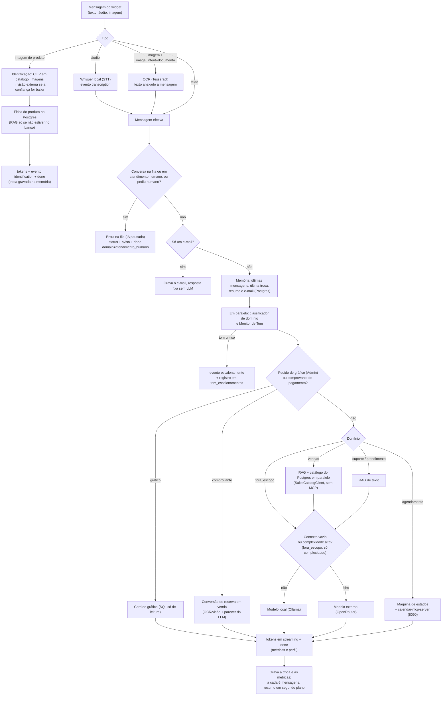

# Arquitetura — Assistente Virtual Multimodal com Roteador Inteligente

> Fonte: adaptado do documento de proposta ao orientador (TCC). Este documento
> é a referência técnica única de arquitetura e escopo — mantenha-o
> atualizado conforme decisões mudam durante o desenvolvimento. `CLAUDE.md` e
> `.agents/rules/project.md` apontam para cá; não duplique decisões neles.

## 1. Objetivo do projeto

Assistente virtual multimodal (texto, imagem e áudio) capaz de atender
clientes em quatro domínios: Vendas, Suporte Técnico, Atendimento ao Usuário e
Agendamento de Visita. O sistema combina um modelo de IA executado localmente
em GPU (16GB) com a possibilidade de acionar modelos externos quando
necessário, apoiado por um Roteador/Orquestrador que interpreta a intenção do
usuário e decide o caminho mais adequado — incluindo busca aumentada por
recuperação (RAG) em bases de dados, documentos, sites e imagens, e o
acionamento de MCPs (Model Context Protocol) em duas direções:

- **Como cliente** de um MCP externo, para marcar visitas diretamente no
  Google Calendar.
- **Como provedor** de um MCP próprio, que expõe catálogo de produtos,
  estoque, preços e manuais, além de ferramentas de validação de
  compatibilidade, frete, cotação e reserva/pedido — tanto para o próprio chat
  quanto para IAs de parceiros integradores.

Além da conversa em si, o sistema reconhece o perfil do usuário (cliente,
lead ou contato esporádico), mantém memória entre interações e monitora o
tom da conversa para acionar um atendente humano quando necessário.

## 2. Visão geral da arquitetura

Fluxo macro: entrada multimodal → pré-processamento (STT para áudio, OCR para
imagem) → Roteador/Orquestrador (intenção + perfil do usuário) → módulos de
domínio (RAG, modelo local, modelo externo, monitor de tom, classificação de
usuário) → MCPs (Google Calendar consumido; MCP B2B provido) → resposta ao
usuário.

```
Entrada multimodal (texto / áudio / imagem)
        │
        ▼
Pré-processamento (STT / OCR)
        │
        ▼
Roteador / Orquestrador  ──── (paralelo) ──── Monitor de tom
        │                                          │
        ├──► RAG (BD, PDFs, sites, imagens)        ├──► Atendente humano
        ├──► Modelo local (GPU 16GB)                    (transferência)
        ├──► Modelo externo
        ├──► MCP Google Calendar (agendamento)
        └──► MCP B2B (catálogo, estoque, preços — provido)
        │
        ▼
   Resposta ao usuário
```

Este diagrama cobre a arquitetura de IA/backend. A interface que o usuário
efetivamente usa (site institucional, produtos, pedidos e o widget de chat
que expõe esse fluxo) é documentada separadamente em `docs/FRONTEND.md`.

### Fluxo de uma mensagem no chat (`POST /api/chat/messages`)

Trazido do antigo `docs/Manuais/DIAGRAMA_FLUXO_CHAT.md` e corrigido contra o
código em 2026-09-28 (o diagrama antigo tinha um domínio `pos_venda`
inexistente, Vendas passando pelo MCP B2B e o Monitor de Tom depois da
resposta). Contrato dos eventos SSE: `docs/FRONTEND.md` §4.



| Entrada | Pré-processamento | Caminho | Eventos SSE |
| --- | --- | --- | --- |
| Texto | — | Memória → classificador e Monitor de Tom → domínio → local ou externo | `conversation`, `status` (se o modelo local estiver carregando), `token`, `escalonamento` (opcional), `done` |
| Áudio | Whisper (`SttClient`) | Transcrição → mesmo caminho do texto | `conversation`, `transcription`, `token`, `done` |
| Imagem de produto | Validação do formato | Identificação (CLIP → visão externa) → ficha do banco ou RAG | `conversation`, `token`, `identification`, `done` |
| Imagem de documento (`image_intent=documento`) | OCR | Texto extraído anexado → mesmo caminho do texto | `conversation`, `token`, `done` |
| Só um e-mail | Regex | Grava o e-mail, resposta fixa | `conversation`, `token`, `done` |
| Qualquer um, com a conversa na fila de atendimento humano (ou pedido de humano) | — | IA pausada; aviso de recebimento, sem LLM | `conversation`, `status` (com o atendente), `token`, `done` (`domain=atendimento_humano`) |

Em toda mensagem de texto que chega ao LLM, `detectar_tentativa_injecao`
registra um log (`tentativa_injecao_detectada`) sem bloquear a resposta, e o
conteúdo não confiável (RAG, catálogo) é isolado por delimitador no prompt
(ver `docs/Manuais/PROMPTS_E_INSTRUCOES_LLM.md`).

Falha de dependência (Ollama, OpenRouter, RAG) vira o evento `error` com
"Serviço temporariamente indisponível".

### Escolhas de tecnologia e alternativas consideradas

Versões e bibliotecas em uso: `docs/CONVENTIONS.md`, seção "Stack". Aqui fica
só o porquê de cada escolha central (conteúdo trazido do antigo
`docs/TECHNOLOGY_STACK.md` na consolidação de 2026-09-28).

- **PostgreSQL, não MongoDB:** os dados são relacionais (produto ↔ estoque
  ↔ pedido ↔ compatibilidade), reserva de pedido precisa de transação ACID,
  e o conector de BD do RAG (R4) lê SQL. É o backend único de catálogo,
  estoque, preços, conversas e perfil.
- **Qdrant, não Pinecone/Weaviate:** open-source, roda num container ao lado
  do resto (sem custo de nuvem), com filtro nativo por payload (domínio,
  categoria), suficiente para o volume do protótipo.
- **Ollama, não vLLM, como runtime local:** API HTTP simples, troca de
  modelo trivial (`ollama pull`) e devolve tokens e tempos (carga x
  geração) em cada resposta, o que reduz o código de instrumentação da
  avaliação (`docs/EVALUATION.md`). O vLLM daria mais vazão sob
  concorrência, desnecessária num protótipo sem carga real.
- **OpenRouter como modelo externo:** uma chave para vários provedores e
  modelos, API no formato OpenAI; o externo só entra quando o roteador
  escala.
- **Next.js separado do FastAPI:** o chat precisa de um frontend dedicado
  (streaming SSE, gravação de áudio, upload de imagem); o backend fica só
  como API.

## 3. Requisitos funcionais

| # | Requisito |
| --- | --- |
| R1 | Modelo de IA rodando localmente em GPU de 16GB, sem depender de nuvem para as tarefas essenciais. |
| R2 | Entrada de chat multimodal: aceitar texto, imagem e áudio. |
| R3 | Roteador/Orquestrador que identifica a intenção do usuário e decide entre modelo interno ou externo. |
| R4 | RAG capaz de buscar em banco de dados, textos, PDFs, sites e banco de imagens. |
| R5 | Conversão de áudio em texto (STT) antes da análise e contextualização no chat. |
| R6 | Tratamento de imagem: uso dirigido (ex.: comprovante solicitado) ou uso espontâneo (busca de produto interno, com fallback para busca externa) — via OCR e identificação de imagem. |
| R7 | Domínios de atendimento: Vendas, Suporte Técnico, Atendimento ao Usuário e Agendamento de Visita, com identificação de intenção pelo orquestrador. |
| R8 | Monitoramento contínuo do tom da conversa, com transferência para atendente humano em casos de urgência ou insatisfação. |
| R9 | Armazenamento da conversa com identificação única, permitindo retomar com um resumo do histórico recente. |
| R10 | Classificação do usuário ao longo da conversa como Cliente, Lead ou Cliente Esporádico. |
| R11 | Módulo de agendamento de visita, reconhecido como intenção própria pelo roteador, que aciona um MCP — preferencialmente o do Google Calendar — para criar o evento. |
| R12 | Exposição de um MCP próprio pela empresa (servidor/provedor), disponibilizando catálogo, estoque, preços e documentação técnica, além de ferramentas de validação de compatibilidade, frete, cotação e reserva/pedido, para uso por IAs de parceiros integradores e, internamente, pelo próprio Roteador/Orquestrador. |
| R13 | Agente autônomo de previsão de estoque: a cada venda ou reserva, analisa o estoque do produto, estima a frequência de baixa e, se prevê falta nos próximos 10 dias, avisa o administrador por e-mail e numa página de mensagens recebidas de agentes (hoje este agente; futuros agentes usam a mesma caixa de entrada). |

**Assimetria intencional entre domínios:** Vendas e Agendamento de Visita
contam, desde o MVP, com ferramentas de ação (o MCP B2B da Seção 6 e o MCP do
Google Calendar, respectivamente). Suporte Técnico e Atendimento ao Usuário
são resolvidos, no protótipo, pela combinação de LLM e RAG (textos, PDFs,
manuais, crawler do site), sem uma camada de ação dedicada — abrir/acompanhar
chamados via ticketing é evolução futura (ver Seção 6 e `docs/ROADMAP.md`).

**Checklist final contra o implementado (revisão de 2026-10-29, Fase 11).**
Suítes na data: backend 1236 passed / 2 skipped; frontend 728 passed (101
arquivos). Os requisitos são 13 (R13 entrou depois do texto original da
Fase 11, que falava em 12).

| # | Status | Onde está / evidência |
| --- | --- | --- |
| R1 | Atendido | Ollama com `gemma4:12b-it-q4_K_M` (`router/ollama_client.py`, `num_ctx` 8192); benchmark de 4 modelos locais em GPU 16 GB (`eval/model_benchmark`) |
| R2 | Atendido | texto/imagem em `api/chat.py` + `api/uploads.py`; áudio via `stt/whisper_client.py` |
| R3 | Atendido | `router/classifier.py` + `router/orchestrator.py`; local x externo via `llm_client.py`/`openrouter_client.py`; acurácia medida em `/avaliacao` |
| R4 | Atendido | RAG de texto/PDF/site/BD/imagem em `rag/` (`ingest`, `crawler*`, `db_connector`, `clip_embedder`, `image_search`); avaliação experimental concluída (Fase 10) |
| R5 | Atendido | `stt/whisper_client.py`, testes `test_stt_whisper_client.py` |
| R6 | Atendido | dirigido: `ocr/image_processor.py` + `ComprovanteEvaluator`; espontâneo: `rag/image_identification.py` com fallback externo |
| R7 | Atendido | quatro domínios em `router/playbooks.py`; `test_integration_domains.py` |
| R8 | Atendido | `router/tone_monitor.py` → transbordo (`atendimento_service`, `/admin/atendimento`) |
| R9 | Atendido | `memory/store.py` e `memory/resumo.py` (id único da conversa e resumo para retomada) |
| R10 | Atendido | `user_profile/classificacao.py` (Cliente / Lead / Esporádico) |
| R11 | Atendido | `router/scheduling.py` + `mcp_client/google_calendar.py`; `/admin/agendamentos` |
| R12 | Atendido | `mcp_server/b2b.py` (catálogo, estoque, preços, manuais, compatibilidade, frete, cotação, reserva, conversão); cliente `cliente-b2b/` |
| R13 | Atendido | `agents/estoque_preditivo.py`, e-mail e caixa de mensagens (`api/admin_mensagens.py`) |

Limitações que continuam declaradas (não são lacunas de requisito): MCP B2B
com chave estática por parceiro, sem ticketing externo e sem CRM (ver Seção 5
e `docs/ROADMAP.md`, "Fora de escopo").

## 4. Fluxos de decisão: imagem e monitoramento de tom

**(a) Tratamento de imagem:** imagem recebida → o sistema **solicitou** um
comprovante/documento (fluxo dirigido)? → **sim:** OCR + validação. → **não**
(padrão — o cliente nunca envia imagem para OCR sem solicitação): fluxo de
**identificação de produto**.

> **Decisão registrada (Fase 3, 2026-09-20 — fluxo de imagem e fallback
> externo):** o padrão para qualquer imagem enviada no chat é a
> **identificação de produto**; o OCR é a exceção, acionado apenas quando o
> sistema solicitou explicitamente um comprovante/extrato. No contrato do
> chat isso é sinalizado por `image_intent`: ausente/`"produto"` → fluxo de
> identificação (padrão); `"documento"` → OCR.
>
> **Correção (2026-10-06):** o frontend (MVP) nunca implementou um
> botão/estado dedicado de "enviar comprovante" — nunca preenche
> `image_intent`. Depender só dele deixava o modo documento inatingível pelo
> chat: uma foto de comprovante legendada "segue comprovante", enviada pelo
> upload genérico de imagem, sempre caía na identificação de produto (o
> cliente recebia "Identifiquei: <produto do catálogo>" em vez da validação
> do pagamento). `app.api.chat` agora ativa o modo documento também quando a
> legenda/mensagem enviada junto da imagem bate com a heurística de texto já
> usada para comprovante sem anexo
> (`app.router.sales_catalog.detectar_intencao_comprovante` — frases como
> "comprovante", "segue o pix", "pagamento realizado" etc.); `image_intent`
> explícito continua aceito e tem prioridade (ex.: telas de admin que já o
> enviam).
>
> **Correção (2026-10-08):** uma imagem sem nenhuma legenda que sinalizasse
> comprovante ainda caía sempre no padrão de identificação de produto, mesmo
> quando o cliente tinha uma reserva pendente de pagamento (`status`
> "reservado"/"pagamento_divergente") em aberto — o estado de reserva nunca
> era consultado antes da decisão de imagem. `app.api.chat` agora também
> consulta `app.router.sales_catalog.buscar_reserva_ativa` (por
> `conversation_id`/`user_email`) antes de decidir: havendo reserva
> pendente, o modo comprovante é tentado mesmo sem legenda/`image_intent`.
> Se o OCR não confirmar que o conteúdo extraído parece dado real de
> transação (`app.router.sales_catalog.texto_parece_conteudo_de_comprovante`),
> o fluxo volta para identificação de produto em vez de insistir — cobre o
> caso de um cliente com pendência mandando, por exemplo, uma foto de
> produto em vez do comprovante. Continua fora de escopo: lembrar que o
> assistente pediu o comprovante num turno anterior sem reserva pendente
> alguma (estado de conversa dedicado), deixado para evolução futura.
>
> **Fluxo de identificação de produto** (motor em
> `app.rag.image_identification`, endpoint `POST /api/rag/images/identify` e
> integração no chat):
> 1. **Catálogo interno (CLIP):** embeda a imagem e busca em
>    `catalogo_imagens`. Se o melhor score ≥ `IMAGE_INTERNAL_CONFIDENCE`
>    (limiar alto, default 0.30, configurável em runtime) → retorna o produto
>    do catálogo, sem chamar o externo.
> 2. **Visão externa (fallback):** se o interno não teve confiança
>    suficiente, consulta um modelo de visão via OpenRouter
>    (`EXTERNAL_VISION_MODEL_NAME`) pedindo resposta objetiva em JSON:
>    `{"produto": "<nome>", "e_do_portfolio": bool, "confianca": 0..1}`. O
>    prompt informa o portfólio da empresa: **produtos de segurança —
>    câmeras, sensores, automação, equipamentos de rede, catracas
>    eletrônicas, identificadores biométricos e gravadores de imagem**.
> 3. **Decisão:** se `e_do_portfolio == true` **e**
>    `confianca >= IMAGE_EXTERNAL_CONFIDENCE` (limiar alto, default 0.80,
>    configurável) → usa o nome retornado (mais o contexto de mensagens
>    recentes do usuário, quando houver) para buscar no **RAG de texto**
>    (collection de texto ativa) e retorna os detalhes do produto. Caso contrário (não é
>    do portfólio, confiança baixa, ou resposta não-parseável) → responde
>    objetivamente que **não identificou o produto**.
> 4. **Detalhes vêm do banco (decisão de 2026-09-27):** produto é dado do
>    cadastro (`produtos` no Postgres); PDFs no RAG ficam para manuais e
>    documentação. Achado o produto (passo 1 com `produto_id` no payload da
>    foto, ou nome casando com um único produto do cadastro — nome da foto
>    sem `produto_id` ou nome devolvido pela visão externa), os detalhes são
>    a ficha do banco: descrição comercial, especificações técnicas,
>    dimensões e peso, com o nome do cadastro no "Identifiquei: …". Sem
>    produto no banco (ou com o banco fora do ar), cai na busca no RAG de
>    texto do passo 3, como antes. `# MVP: casamento por nome só aceita um
>    candidato único (nome contido um no outro, sem acentos); sem ranking.`
>
> Os três parâmetros (`EXTERNAL_VISION_MODEL_NAME`, `IMAGE_INTERNAL_CONFIDENCE`,
> `IMAGE_EXTERNAL_CONFIDENCE`) têm default no `.env` (apenas para popular o
> frontend) e são ajustáveis em runtime via `GET`/`PUT
> /api/admin/runtime-settings`, exibidos na tela `/admin/modelos`. `# MVP:
> chamada a provedor externo pago no fluxo de imagem — decisão consciente,
> não evolução futura; sem busca reversa de imagem nem catálogo visual
> externo, o "externo" é um modelo de visão que só nomeia/classifica o
> produto`.

> **Decisão registrada (2026-10-06 — política de custo mínimo para imagens
> de documento: recursos internos antes de visão externa):** diretriz do
> desenvolvedor ao revisar a leitura de comprovante no chat — para
> **qualquer imagem classificada como documento** (comprovante de
> pagamento/PIX/TED, nota fiscal **ou** folder/página de catálogo para
> cadastro de produto), a ordem de tentativa passa a ser sempre: (1) OCR
> local (Tesseract, `app.ocr.image_processor.extract_text_from_bytes`); (2)
> interpretação do texto extraído por LLM local (Ollama, texto); (3) se o
> OCR não extrair texto utilizável ou a interpretação local falhar/for de
> baixa confiança → **visão local** (ver decisão abaixo, "Visão multimodal
> local resolvida — reaproveitar o modelo de texto já residente"); (4) só se
> a visão local também falhar ou o Ollama estiver indisponível → fallback
> para visão externa (hoje OpenRouter). O fluxo de **identificação de
> produto por imagem qualquer** (passos 1–4 da decisão de Fase 3: CLIP
> interno → RAG de texto → visão externa) já é "recurso interno antes de
> externo" desde que foi implementado — não precisa de um passo novo de
> visão local no meio, fica como está.
>
> **Decisão registrada (2026-10-06 — visão multimodal local resolvida:
> reaproveitar o modelo de texto já residente, sem modelo adicional):**
> resolve o item do roadmap "Investigar visão multimodal no modelo local"
> (Fase 2/Extra). Teste isolado (script ad hoc, não commitado, fora de
> `app.*`) chamando `POST /api/generate` do Ollama com `images` diretamente
> contra `LOCAL_MODEL_NAME` (`gemma4:12b-it-q4_K_M`) mostrou que esse modelo
> **já tem capability `vision`** (`ollama show` lista um projetor CLIP
> embutido — descoberta não óbvia, não documentada antes). Rodado com os
> prompts exatos de produção (`_VISION_PROMPT` de
> `app.rag.image_identification` e o prompt do `ComprovanteEvaluator`)
> contra 2 fotos reais de produto e 1 comprovante real já existentes no
> repo: identificou corretamente o produto (categoria + `e_do_portfolio`,
> confiança 0,90–0,98) e extraiu `valor_pago`/`codigo_transacao` do
> comprovante **exatamente certos**. `comprovante_valido` veio `false`
> porque o modelo notou se tratar de um comprovante fictício (banco/empresa
> de teste, data futura) — comportamento do *prompt* ("auditor financeiro"),
> não específico de rodar local, o mesmo aconteceria com qualquer modelo
> (local ou externo) recebendo esse prompt. Latência 15–18s por chamada
> (bem mais lenta que texto puro, mas sem rede/rate limit).
> **Consequência prática: não é preciso baixar nem manter residente um
> segundo modelo multimodal** (decisão de 2026-10-06; a Fase 10 depois
> incluiu Qwen2.5-VL e Gemma 4 E4B entre os candidatos a `LOCAL_MODEL_NAME`,
> e a visão local acompanha o modelo que vencer) — o passo (3) acima chama o Ollama com o
> `LOCAL_MODEL_NAME` configurado, reaproveitando a mesma instância já
> residente em VRAM (`keep_alive=-1`) usada para texto, sem custo extra de
> carga/VRAM. Risco tratado: se o admin trocar `LOCAL_MODEL_NAME` em
> runtime (`/admin/modelos`) para um modelo sem capability `vision`, a
> chamada de visão local falha e cai com segurança para o passo (4), sem
> propagar erro ao usuário. **Implementado** (visão local religada no fluxo
> de chat, `local_vision_client` em `orchestrator.py`; ver `docs/ROADMAP.md`,
> política de custo mínimo de 2026-10-06).
>
> **Gaps encontrados que contrariavam essa diretriz, todos já corrigidos**
> (achado de 2026-10-06, revisão da leitura de comprovante no chat; gap 3
> achado numa revisão separada no mesmo dia, ao revisar o MCP B2B):
> 1. ~~Comprovante no chat já roda OCR primeiro, mas sem fallback de
>    visão quando o OCR falha.~~ **Corrigido**: `processar_conversao_comprovante`
>    (`app.router.sales_catalog`) criava `ComprovanteEvaluator(llm_client=...)`
>    **sem `vision_client`** — diferente do fluxo administrativo
>    (`app.api.admin_pedidos_conversao`), que já passava
>    `vision_client=external_client`. Resultado: se o OCR não extraía nada
>    útil de uma foto de comprovante malfeita (ângulo, luz, resolução — o
>    caso mais comum vindo do cliente final pelo celular), o cliente só
>    recebia um pedido para reenviar, sem nenhuma tentativa de visão. Religado
>    em `app.router.orchestrator`/`sales_catalog`, ver testes em
>    `tests/test_comprovante_evaluator.py`/`tests/test_chat_conversao_reserva.py`.
> 2. ~~Imagem avulsa de folder/catálogo sempre usa visão externa, sem
>    tentar OCR+LLM texto primeiro.~~ **Corrigido** em
>    `app.catalog_extractor.extractor.extract_catalog_stream` — ver testes
>    em `tests/test_catalog_extractor.py`.
> 3. ~~MCP B2B (`converter_reserva_venda`, Modo 5) nunca recebia nenhum
>    cliente de LLM/visão.~~ **Corrigido**: `create_b2b_mcp_server`
>    (`app.mcp_server.b2b`) instanciava `ComprovanteEvaluator()` **sem
>    nenhum argumento** — nem `llm_client`, nem visão nenhuma. Resultado: o
>    parceiro B2B recebia a avaliação menos inteligente de todo o sistema
>    (só o fallback heurístico por regex para texto, só OCR sem fallback
>    nenhum para imagem) — pior do que o chat tinha *antes* da correção do
>    gap 1. `create_b2b_mcp_server` ganhou os parâmetros opcionais
>    `local_client`/`external_client` (mesmo padrão `OllamaClient`/
>    `OpenRouterClient` do resto do projeto); `scripts/run_mcp_b2b_server.py`
>    (processo separado do FastAPI principal, não herda `app.state`) passou
>    a instanciar os dois e repassar. Testes em
>    `tests/test_mcp_converter_reserva.py`.

**(b) Monitoramento de tom e transbordo humano:** nova mensagem no chat → classificador de
sentimento/urgência → ultrapassou o limiar de urgência/insatisfação? →
**não:** fluxo normal continua. → **sim:** alerta e registro para
acompanhamento humano (`tom_escalonamentos`). A especificação de arquitetura para a central de atendimento ao vivo e fila de suporte com transbordo humano (*Live Agent Takeover* com locks atômicos) está detalhada em `docs/superpowers/specs/2026-10-03-atendimento-humano-transbordo-design.md`.

## 5. Escopo do MVP e evolução futura

Três decisões de escopo:

1. Integração com CRM está **fora do escopo** do projeto.
2. Agendamento de visita é uma nova intenção do roteador que aciona um MCP
   **externo** (preferencialmente Google Calendar), em vez de um módulo de
   agenda construído internamente.
3. O MCP de integração B2B (R12) nasce como **servidor interno**, consumido
   primeiro pelo próprio chat, e só evolui para exposição real a parceiros
   externos depois (ver Seção 6).

R4 estabelece que o RAG deve buscar em BD, textos, PDFs, sites e banco de
imagens — por isso, conector a BD relacional, crawler de sites e RAG
multimodal sobre imagens são **obrigatórios no MVP**, em versões
simplificadas: o conector ao BD é somente leitura, sem sincronização
incremental; o crawler navega a partir de uma URL semente informada pelo
admin, com profundidade e teto de páginas por execução, disparo manual; o
catálogo de imagens do RAG multimodal tem reranking básico.

As decisões abaixo são o registro vigente de cada escolha (o raciocínio
longo e as alternativas descartadas estão no histórico do git). As marcadas
"além do MVP" foram feitas a pedido explícito do dono e entram na revisão
final (Fase 11).

**Decisão registrada (Fase 2): o conteúdo recuperado do RAG é injetado no
prompt.** Com a busca vetorial real no Qdrant, os trechos recuperados vão
para o prompt do LLM (resposta fundamentada nos PDFs/textos indexados); o
sinal vazio/não-vazio continua decidindo local x externo.

**Decisão registrada (Fase 2): ingestão por endpoint e tela, além do script.**
`POST /api/rag/documents` (PDF/texto + `domain`) e a página `/admin/ingestao`
complementam `backend/scripts/ingest_sample_docs.py` (lote repetível).
`# MVP:` sem deduplicação/reingestão incremental (limitação de
`app.rag.qdrant_client.upsert_chunks`).

**Decisão registrada (além do MVP, 2026-09-14): registro persistente de
documentos.** Toda ingestão cria um registro em `rag_documents` (Postgres);
o documento pode ser listado e excluído (linha + pontos no Qdrant, ligados
por `document_id` no payload). Spec:
`docs/superpowers/specs/2026-09-14-registro-documentos-rag-design.md`.

**Decisão registrada (além do MVP, 2026-09-15): múltiplos perfis de
collection.** Cada collection é um perfil **imutável** (chunk size/overlap,
embedding, dimensão, distância, HNSW, quantização, payload index); uma é a
"ativa" e é a que o chat usa; as demais servem de comparação no playground
de busca administrativo. O arquivo original fica em
`backend/data/rag_uploads/`, permitindo reingerir em outra collection. Spec:
`docs/superpowers/specs/2026-09-15-rag-collections-config-design.md`.

**Decisão registrada (Fase 10, 2026-10-18): a avaliação cobre um único perfil
de collection de texto.** O chat usa só a collection ativa e a Avaliação
(`docs/EVALUATION.md` Seção 2.1) escolhe **um** perfil vencedor, aplicado a
ela. Domínios se separam pelo filtro `domain` no payload, não por collection;
texto e imagem ficam em collections distintas (CLIP tem outra dimensão).
Motivo: corpus pequeno, busca exata, e embeddings diferentes por collection
obrigariam várias embedagens da consulta e scores incomparáveis. **Evolução
futura:** collections de texto simultâneas com perfis próprios. Os
resultados do benchmark de modelos valem para o perfil ativo na rodada.

**Decisão registrada (Fase 10, 2026-10-17 a 2026-10-28): perfil vigente da
collection de texto.** A otimização de ingestão (`docs/EVALUATION.md` Seção
2.1) começou por três medições que mudaram o plano:

1. **Truncamento silencioso.** O `paraphrase-multilingual-MiniLM-L12-v2` tem
   `max_seq_length = 128` tokens; em pt-BR o teto efetivo é ~552 caracteres,
   então `chunk_size = 800` descartava ~31% de cada chunk sem aviso.
2. **Modelo mal colocado em português.** No MTEB-BR (93 modelos,
   `arxiv.org/html/2607.04581v2`) ele é o 93º de 93; os líderes são modelos
   de 8B+ que não cabem na VRAM ao lado do gerador de 12B.
3. **Escala do corpus.** ~151 a 1.210 vetores: busca exata (limitação abaixo).

**Código que ficou:** `app.rag.chunking.chunk_text` conta `chunk_size` e
`chunk_overlap` em **tokens** (tokenizer do modelo da collection) com corte
recursivo; `TextEmbedder.embed(texts, *, is_query)` aplica **prefixos
assimétricos** quando o modelo exige (embeddinggemma, e5; ver
`docs/Manuais/PROMPTS_E_INSTRUCOES_LLM.md`); `_FALLBACK_MIRRORS` usa o mirror
`unsloth/embeddinggemma-300m` (o original é *gated*).

**Resultado medido** (Etapas 1 a 7; números em `docs/EVALUATION.md`):

- **Embedding: `BAAI/bge-m3`** (1024 dims, janela 8192, sem prefixo).
  Recall@5 0,944 contra 0,636 do MiniLM; empata com o embeddinggemma-300m
  (McNemar p = 1,0), desempatado por ingestão 1,7× mais rápida e janela
  maior. Custo: 3,3 GB de VRAM.
- **Chunking: 768 tokens, overlap 15% (115).** De 512 a 1024 é um platô;
  só 128–256 degradam; o overlap não tem efeito consistente.
- **Recusa:** nenhum embedding separa pergunta com resposta de sem resposta
  pelo score (menor positivo 0,440; maior negativo 0,618). A recusa foi para
  o prompt (v2); o limiar 0,60 foi **rejeitado** (fonte correta 213 → 198).
  Vigentes: `rag_top_k = 5`, `rag_score_threshold = 0,35`.
- **Distância e índice (Etapa 5):** `cosine` mantido; índice `keyword` em
  `domain` não criado (p95 6,48 → 6,97 ms). Para `euclid` o
  `score_threshold` do Qdrant é limite superior, então `run_etapa5.py` usa
  `thr_sem_corte = 10.0`.
- **Etapa 7 (juiz):** bge-m3 768/115 contra MiniLM 800/100, nas mesmas 222
  perguntas: nota 2,74 → 4,14; fonte correta 156 → 213.

**Estado do código:** os defaults continuam MiniLM e chunks 512/51
(`chunking.py:25-26`, `models/rag.py:115-116`); o perfil vencedor é **dado de
collection**. A ativa é `docs_texto_bge768` (1024 dims); `docs_texto` (MiniLM
800/100) e `docs_texto_minilm800c` (baseline da Etapa 7) ficam para
comparação. Scripts em `backend/eval/rag_ingestion/`, cobertos por
`tests/test_rag_ingestion_eval.py`.

**Limitação de escala (Fase 10, 2026-10-17): HNSW e quantização não são
mensuráveis neste corpus.** O corpus (`docs/Manuais_fornecedor/ControlId/`,
97 PDFs) rende **667.291 caracteres úteis** (medido com o extrator de
produção em `backend/eval/rag_ingestion/auditar_corpus.py`), ou ~151 a 1.210
chunks e 0,89 a 4,73 MB de vetores. Dois limiares do Qdrant impedem que o
HNSW seja construído ou percorrido: `full_scan_threshold` (10000 KB ≈ 9,8 MB;
margem 2,1× sobre o pior caso) e `indexing_threshold` (20000 KB por segmento;
margem 4,1×). A busca é exata, logo `hnsw_m`, `hnsw_ef_construct`,
`hnsw_payload_m` e `quantization_type` têm **efeito zero** em recall e
latência. Continuam configuráveis por perfil, mas **não foram varridos**
(seria ruído); o resultado negativo entra no relatório como limitação. Um
teste sintético com vetores replicados foi **descartado** (mediria outro
sistema). A multi-tenancy do Qdrant (`m=0` + `payload_m=16`) fica fora de
escopo: impede a busca cross-domain usada no fallback
(`Settings.rag_search_domain_fallback`).

**Registro condensado: refatoração visual M3 Glass (2026-10-17).** Spec em
`docs/superpowers/specs/2026-10-17-m3glass-visual-refactor-design.md`
(Home, Header, Footer e `/produtos`; rollback do frontend: commit `7eebebb`).
O que continua valendo:

- **`resolveImageUrl`** (`frontend/lib/utils/resolveImageUrl.ts`) é
  compartilhada com o card de produto do chat; `productName` só age como
  fallback para URL nula. O card do chat deve continuar chamando-a com um
  argumento.
- **Vitrine não prova indexação CLIP:** o estado do índice
  `catalogo_imagens` se confere em `/admin/produtos` ou pela contagem de
  vetores, nunca pela aparência do site.
- **`/avaliacao` usa o layout global** (Header/Footer escuros).
- **`docs/Manuais_fornecedor/` é `gitignored`**; as fotos copiadas para
  `frontend/public/images/products/` são versionadas (decisão consciente).
- **Testes que guardam o contrato** (asserção alterada = quebra de contrato):
  `ChatProductCard`, `ProductCard`, `ProdutoDetalhePage`,
  `LayoutHeaderFooter`, `apiBaseUrl` e `ChatModal`, em `frontend/tests/`.

**Decisão registrada (além do MVP, 2026-09-21): finalidade da collection
(`purpose`).** `chat` (default, pública) ou `mcp_b2b` (restrita ao canal
B2B). Uma collection `mcp_b2b` é ingerida pela mesma `/admin/ingestao`, **nunca
é ativada** (409) nem buscada pelo chat; `ActiveCollectionRagClient.search`
falha fechado se a invariante for quebrada. O consumo pelo servidor MCP B2B
é da Fase 5. Spec: `docs/superpowers/specs/2026-09-21-ingestao-mcp-b2b-design.md`.

**Decisão registrada (além do MVP, 2026-09-16): gerenciador de modelos
locais (`/admin/modelos`).** Lista os modelos do Ollama, troca em runtime o
modelo do chat e baixa novos (biblioteca do Ollama ou
`ollama pull hf.co/<usuário>/<repo>`), com download em background e
progresso por polling. Ferramenta de teste manual: **não substitui** a
escolha formal do modelo na Fase 10. Spec:
`docs/superpowers/specs/2026-09-16-local-model-manager-design.md`.

**Decisão registrada (além do MVP, 2026-09-17): parâmetros de execução em
runtime.** `GET`/`PUT /api/admin/runtime-settings` (atualização parcial)
ajusta a temperatura do modelo local (`null` = default do modelo), os
timeouts do local e do externo e `QdrantRAGClient.search_domain_fallback`.
A temperatura também afeta a classificação de intenção do roteador (baixá-la
reduz a instabilidade em mensagens ambíguas). Desde 2026-10-03 os parâmetros
são persistidos em Postgres e restaurados no boot (ver a decisão de
residência do modelo mais abaixo).

**Decisão registrada (além do MVP, 2026-09-27): modelo externo em runtime.**
O card "Modelo externo (OpenRouter)" (`OpenRouterModelCard.tsx`) troca
`external_model_name` (`OpenRouterClient.model`); vale para as respostas
escaladas, o classificador Jev e o Monitor de Tom. `# MVP:` sugestões fixas
no frontend; histórico no localStorage. Risco: modelos `:free` têm limite
baixo e o 429 aparece como "Serviço temporariamente indisponível".

**Decisão registrada (Fase 2, R4): conector de BD relacional.** Reaproveita o
Postgres do `docker-compose.yml`. A tabela fictícia `produtos` vem da
migração `0003_produtos_fixture.py`; `app.rag.db_connector.read_table_as_text`
é genérico (reflexão do SQLAlchemy) e cada linha vira um documento via
`ingest_bytes` (`<tabela>_row<N>.txt`). Só CLI:
`backend/scripts/ingest_db_table.py --table <nome> --domain <dominio>`.
`# MVP:` somente leitura, reforçada por `postgresql_readonly=True` (o banco
rejeita escrita; dialetos sem a opção, como o SQLite dos testes, a ignoram);
sem sincronização incremental.

**Decisão registrada (Fase 2, 2026-09-16): `create_collection` com lock.**
`QdrantRAGClient.create_collection` usa um `asyncio.Lock` por instância
contra a corrida entre checar e criar (duas criações simultâneas com o mesmo
nome devem dar `CollectionAlreadyExistsError`, não o erro genérico do
Qdrant). Vale porque o client é singleton por processo
(`request.app.state.qdrant_client`). `# MVP:` protege só um worker Uvicorn.

**Decisão registrada (Fase 3, R6): OCR para imagens dirigidas.**
`POST /api/chat/messages` aceita `image` (base64 PNG/JPG/WEBP, formato
detectado por magic bytes). O OCR (`pytesseract`, Tesseract 5, `por+eng`)
extrai o texto e o concatena à mensagem antes do orchestrator. Formato
inválido → 400; Tesseract indisponível → 503. `# MVP:` uso dirigido
(comprovantes), sem classificação de tipo nem pré-processamento (binarização,
deskew).

**Decisão registrada (Fase 3, R6): busca multimodal via CLIP.** `ClipEmbedder`
(ViT-B/32, 512 dims, `sentence-transformers`) sobre a collection
`catalogo_imagens` (cosine, criada na primeira ingestão). Endpoints
`POST /api/rag/images` e `POST /api/rag/images/search` (imagem ou texto, mesmo
espaço vetorial). `# MVP:` catálogo parcial, sem deduplicação; limiar 0,20
(scores CLIP são menores que os do texto, 0,35). **Reranking básico:**
`app.rag.image_search` recupera `top_k * 3` e `rerank_image_results` soma um
bônus de 0,05 (só chave de ordenação) a quem tem o `domain` consultado;
heurístico, sem cross-encoder.

**Decisão registrada (Fase 3): playbooks por domínio.** Vendas, suporte e
atendimento têm um prompt de sistema estático em `app.router.playbooks`,
anteposto pelo orchestrator (`fora_escopo` tem um playbook curto de cortesia,
para saudações sem despejar catálogo). Vendas oferece
proativamente a visita; Suporte e Atendimento são LLM + RAG, sem ação.
`# MVP:` strings estáticas, sem versionamento nem edição em runtime. O
**agendamento não usa playbook**: é o fluxo procedural
`orchestrator._handle_agendamento` + `app.router.scheduling` (máquina de
estados de coleta/validação/confirmação; spec
`docs/superpowers/specs/2026-09-21-agendamento-mcp-calendar-design.md`).

**Decisão revista (Fase 4A, troca do MCP de Calendar, R11, 2026-09-23):
agendamento via MCP de terceiro.** O assistente **consome** um MCP existente em vez de
construir um servidor próprio. O servidor oficial do Google
(`calendarmcp.googleapis.com`) foi descartado: Developer Preview, exige
aprovação manual que não aceita contas Gmail pessoais. Roda no lugar o MCP de
terceiro self-hosted `calendar-mcp-server` (PyPI,
https://github.com/deciduus/calendar-mcp;
`uvx calendar-mcp-server serve --transport http --port 8090`); REST direta
abandonaria o objetivo de R11 (consumir um MCP externo).

- **Autenticação:** o OAuth (client "Desktop app", escopo
  `https://www.googleapis.com/auth/calendar`) é do próprio
  `calendar-mcp-server` (`calendar-mcp-server auth`, `TOKEN_FILE_PATH`). O
  backend não guarda client_id, secret nem refresh token: só fala MCP HTTP
  (`CALENDAR_MCP_URL`, `GoogleCalendarMCPClient`).
- **Tools:** `find_events` (disponibilidade) e `create_event` (`summary`,
  `start_time`/`end_time` ISO 8601, `description`, `attendee_emails`; o nome
  do visitante vai na descrição). Mais `delete_event` (cancelamento).
- **Mensagens ao visitante** são templates determinísticos
  (`mensagem_campos_faltando`, `mensagem_pedir_confirmacao`,
  `mensagem_sucesso`), para o LLM não inventar dado numa ação irreversível.
- `# MVP:` endpoint MCP local sem autenticação própria, não exposto.

**Decisão registrada (Fase 7, R11, 2026-09-29): gestão e cancelamento de
agendamentos.** Abordagem híbrida sincronizada (spec
`docs/superpowers/specs/2026-09-29-gestao-agendamentos-design.md`):
(a) a tabela `agendamentos` (migração `0015`) guarda o histórico auditável
(`user_email`, datas, `status` confirmado/cancelado, `origem` chat/manual_admin,
`google_event_id`, `conversation_id`); (b) ao confirmar no chat, o
orchestrator chama `create_event` e persiste o registro; (c) o cancelamento
(`POST /api/agendamentos/{id}/cancelar`) marca `cancelado` (mantém histórico)
e remove o evento via `delete_event`; (d) `/admin/agendamentos` tem duas
abas (agendamentos do sistema e consulta em tempo real do Calendar) e
permite agendar manualmente (`POST /api/agendamentos/admin/manual`) com
checagem de conflito.

**Decisão registrada (Fase 4/7, R11, 2026-09-29): só eventos do sistema contam
na disponibilidade.** `create_event` marca o evento com o prefixo `[Sistema]`
no `summary` e `[origem:sistema]` na descrição (`is_system_event`);
`is_time_available` e `list_events` consideram **somente** eventos marcados,
para que compromissos alheios na agenda não bloqueiem visitas. `# MVP:`
risco assumido: evento criado à mão fora do sistema não bloqueia e pode
colidir; produção usaria um calendário só de visitas. Teste:
`tests/test_google_calendar_client.py`.

**Decisão registrada (Fase 7/8, R11, 2026-09-29): duração da visita.**
`DURACAO_VISITA` passa de 30 para 60 minutos; o agendamento manual do admin
ganha `duracao_minutos` (padrão 60, passos de 15). Os botões "Agendar Visita
pelo Chat" (`useChatStore.openVisitChat`) pré-preenchem a mensagem com
nome/e-mail do usuário logado.

**Decisão registrada (Fase 7, R10, 2026-09-29): usuários e perfil
Administrador.** `POST /api/auth/register` cadastra usuário (perfil `Cliente`;
senha mock `12345`, o login também aceita `admin123`); `admin@example.com` ou
e-mail iniciado em `admin@` vira `Admin`; cadastrar um `Admin` por outro
e-mail exige `requester_email` de um Admin (senão 403). `GET
/api/auth/users` lista os clientes com o perfil calculado. No frontend, o
menu ⚙️ (`AdminGearMenu`) só aparece para `Admin`, com "Gerenciar Usuários"
(`/admin/usuarios`) e "Criar Nova Conta" (`/conta/cadastro`);
`/pedidos/historico?email=` abre a inspeção administrativa do histórico de
outro usuário. `# MVP:` perfil por prefixo de e-mail, sem RBAC; o
`requester_email` não é verificado por sessão real (mesmo modelo mock do
projeto). Testes: `tests/test_auth_api.py`, `AdminUsuariosPage.test.tsx`,
`AdminGearMenu.test.tsx`.

**Decisão registrada (qualidade, 2026-09-23 e 2026-09-24): `think: false` nas
chamadas ao Ollama.** Modelos com a capability `thinking` (como o
`gemma4:12b-it-q4_K_M`) raciocinam antes de responder, mesmo para um JSON
curto: medido 2684 tokens e ~50 s para ~30 tokens de resposta, com a
extração de `data_hora` errada; com `think: false`, 2,6 s e 91 tokens,
correto. `OllamaClient.generate()` (classificadores/extratores:
`classifier._classify_with_llm`, `scheduling.extract_booking_slots`,
`rag.crawler_classifier`) manda `think: false`. Correção posterior, achada no
E2E do Monitor de Tom: `generate_stream()` também precisa dele, porque o
modelo (testado com `qwen3.5:9b`) podia gastar todo o orçamento no
raciocínio e fechar com `done_reason: "length"` e resposta vazia, mostrada
ao usuário como "(sem resposta do modelo, tente novamente)". O Ollama ignora
`think` em modelos sem a capability. `# MVP:` sem reativar o raciocínio
seletivamente.

**Decisão registrada (qualidade, 2026-09-23): tabela dos próximos 14 dias na
extração de agendamento.** `extract_booking_slots` recebe o parâmetro
obrigatório `timezone` e inclui no prompt a data de hoje e uma **tabela dos
próximos 14 dias com o dia da semana já calculado**
(`_formatar_proximos_dias`). Só informar "hoje é X" corrigiu o ano, mas o
modelo ainda errava o dia da semana ("quarta-feira que vem" virava quinta);
consultar tabela é mais confiável que calcular. `# MVP:` janela fixa de 14
dias.

**Decisão registrada (Fase 2, 2026-09-17): `pdfplumber` com detecção de 2
colunas.** `app.rag.pdf_extract.extract_text_from_pdf` trocou `pypdf` por
`pdfplumber` e detecta layout de 2 colunas (corredor vertical sem palavras na
faixa de 15% a 85% da largura, com no mínimo 2% da largura e 15 pt), extraindo
cada coluna separadamente; os catálogos têm produtos lado a lado e o `pypdf`
embaralhava os vizinhos. `chunk_text` também preserva quebras de linha como
pontos de corte. `# MVP:` só 2 colunas com corredor limpo; os demais casos
caem na extração de página inteira (sem regressão). PDFs escaneados seguem
sem OCR (R6).

**Decisão registrada (Fase 2/R3, 2026-09-17): fallback de domínio como flag.**
O fallback que refazia a busca sem filtro de `domain` quando vinha vazia
quebrava o isolamento entre domínios e o sinal de escalonamento (RAG vazio →
externo). Virou a flag `Settings.rag_search_domain_fallback`
(`RAG_SEARCH_DOMAIN_FALLBACK`), **desligada por padrão**. `# MVP:` só para
experimento.

**Decisão registrada (além do MVP, 2026-09-17): telemetria por mensagem.**
`POST /api/chat/messages` devolve modelo, tokens de entrada/saída, latência,
TTFT (`prompt_eval_duration` do Ollama), TPS (`eval_duration`), custo
estimado e tempo/quantidade/score médio da busca RAG, com o arquivo e o score
de cada chunk (`rag_chunks`); contrato em `docs/FRONTEND.md` §4. O
`ChatModal` mostra o painel e exporta CSV/JSON
(`frontend/lib/utils/exportMetrics.ts`). Motivo: alimentar a Fase 10. É
persistida em `ConversaMensagem.metricas` (migração `0012`); o TTFT fica
`null` para o externo (OpenRouter não o expõe). Correções de 2026-10-08:
`GET /api/chat/conversations/{id}` cortava em 50 mensagens e o export
filtrava só as do assistente (detalhe em `docs/ROADMAP.md`, "Telemetria de
Inferência no Chat").

**Decisão registrada (ledger unificado de uso de IA, 2026-10-08).** A tabela
`ai_usage_events` (`AiUsageEvent`, migração `0024`) e
`app.services.ai_usage.registrar_uso_ia` registram todo uso de modelo de
geração (local ou externo, texto ou visão) com `origem` (chat/b2b/admin),
`ambiente` (interno/externo), `modelo`, `operacao`, tokens e custo em USD.
Motivo: não dava para separar visão interna x externa no `/admin/metricas`,
e o custo de visão do avaliador de comprovante e a telemetria do
classificador/monitor de tom Jev nunca eram capturados. Sessão explícita /
fire-and-forget / fallback global. Spec:
`docs/superpowers/specs/2026-10-08-ledger-uso-ia-origem-ambiente-modelo-design.md`.

- **`ComprovanteEvaluator`** recebe `origem` e `llm_ambiente` como
  parâmetros keyword-only **sem default**: a classe é compartilhada por chat
  (`router/sales_catalog.py`), B2B (`mcp_server/b2b.py`) e admin
  (`api/admin_pedidos_conversao.py`, ×2), e um default mislabelaria os
  chamadores.
- **Migração sem dual-write:** `extract_page_products_vision` e o
  `crawler_classifier.classify_page` migraram de `IngestionCostEvent` para o
  ledger. A estimativa de tokens por tamanho de texto do caminho antigo foi
  descartada (contraria a semântica `None` = não capturado).
- **Fechamento (item E):** `/admin/metricas` lê **somente** `ai_usage_events`;
  o histórico pré-ledger foi descartado sem backfill (decisão do dono) e
  `IngestionCostEvent` ficou no banco sem leitor nem escritor. O painel
  distingue `None` (`—`) de `0.0` (`$0.0000`) e conta
  `chamadas_sem_custo_medido`.
- **Fronteira (2026-10-12):** ficam **fora, em definitivo**, o resumo
  periódico (`app.memory.resumo`), o STT (Whisper) e os embeddings de texto e
  CLIP (`qdrant_client`, `image_search`): rodam sempre localmente e sem custo
  em USD, e instrumentá-los custaria 6 call sites em caminhos quentes sem
  mudar nenhum número de custo. O painel conta chamadas de **geração**; a
  latência da Fase 10 é medida por fora, em `backend/eval/`. A fronteira está
  também em `app.services.ai_usage`.

**Decisão registrada (fora do MVP, 2026-10-13; atualizada em 2026-10-16): tela
`/admin/ferramentas`.** Reúne Graphify, Repowise e GitNexus, as ferramentas de
inteligência de código do desenvolvimento (item "Extra fora do MVP" no
`docs/ROADMAP.md`; não é um dos 13 requisitos). (1) A checagem "está no ar?"
é feita no backend (`app.api.admin_ferramentas.sondar_servidor`, timeout de
1,5 s), porque do navegador não se distingue servidor desligado de bloqueio
de CORS; (2) o `graphify-out/graph.html` (~3 MB) é servido por endpoint
administrativo, com iframe autenticado por `?token=`; (3) servidor fora do ar
devolve `200` com `online: false` e o comando para subir. `# MVP:` portas
fixas, ajustáveis por `REPOWISE_WEB_URL`, `GITNEXUS_WEB_URL` e
`GRAPHIFY_OUT_DIR`.
Acesso externo (2026-10-16): as portas públicas do Caddy
(`infra/caddy/Caddyfile.ferramentas`: 3002 → Repowise, 4747 → GitNexus)
nasceram com `basic_auth`; a senha se perdeu e o dono decidiu **remover a
autenticação** (o quadro embutido não envia `Authorization`). `# MVP:` as
portas expõem código e análise sem proteção; a mitigação é operacional
(encaminhar no roteador só enquanto se usa de fora). A SPA do GitNexus tem o
backend `localhost:4747` fixo no bundle, então `urlDeVisualizacao`
(`frontend/lib/api/ferramentas.ts`) acrescenta `?server=` apontando para a
origem da página (casado com o GitNexus 1.6.12). A política vigente de uso
das ferramentas está em `docs/CONVENTIONS.md`; confira se a tela ainda
descreve as três.

**Decisão registrada (Streaming SSE do chat, R2/R3, 2026-09-17).**
`POST /api/chat/messages` devolve a resposta como stream **Server-Sent Events**
(`text/event-stream`), sem endpoint `GET` de stream separado (evita duplicar a
validação de entrada e histórico). Eventos, em ordem: `conversation`,
`transcription` (opcional, áudio), `status` (opcional, modelo ainda não
carregado), `token` (zero ou mais), e `done` (telemetria completa) ou `error`
(falha de dependência **depois** de o stream abrir; o HTTP já é 200). Erros de
validação anteriores à abertura continuam 400/422/503 normais. A troca só é
gravada na memória (R9) quando o `done` chega. Contrato em `docs/FRONTEND.md`
§4. `# MVP:` sem reconexão nem `Last-Event-ID`: se a conexão cair, o cliente
reenvia a mensagem inteira.

**Decisão registrada (Vendas, R3, 2026-10-13): quantidade e fechamento.** A
quantidade da cotação é a última pedida pelo cliente (o extrator ignora
números de falas do assistente) e o bloco do catálogo a repete separada do
estoque. O chat de Vendas não cria nem reserva pedidos (reserva é do MCP B2B).
Com o visitante logado (`user_email`), o playbook confirma produto,
quantidade e total e oferece o fechamento (finalização na página Pedidos);
deslogado, só apresenta a proposta e informa que fechar exige login. Visita
só é oferecida se o cliente demonstrar desistência. `# MVP:` correção por
prompt; o card segue o dado do banco.

**Decisão registrada (R3, 2026-10-13): saudação pura não escala.** `classify()`
reconhece saudações e agradecimentos puros ("bom dia!", "obrigado") por
conjunto fechado de palavras (ao menos uma âncora, até 6 palavras) e devolve
`fora_escopo`/`baixa`/`confidence=1.0` com `provider_efetivo="regras"`, sem
LLM nem RAG. Motivo: o LLM local classificava "bom dia" como `atendimento`, a
busca vazia (~10 s) disparava `rag_vazio` e a saudação ia ao externo.
Confirmações curtas ("sim", "ok") ficam de fora, pois dependem do contexto.

**Decisão registrada (RAG com contexto de fallback, R4, 2026-09-17).** Quando a busca com
a mensagem isolada vem vazia e há histórico recente, `orchestrator.handle_message`
faz uma segunda busca com o histórico concatenado (`MENSAGENS_RECENTES = 3`,
`app.memory.store`). Evita escalar ao externo (`rag_vazio`) em perguntas de
acompanhamento ("quais outras opções?"). `# MVP:` sem reescrita de query por
LLM.

**Decisão registrada (além do MVP, 2026-09-23; atualizada em 2026-09-28):
três modos do classificador de intenção** (`intent_router_provider`, em
runtime pelo `/admin/modelos`):
1. `"heuristica"` (Local Regras): só palavras-chave; inconclusivo vira
   `fora_escopo`, sem LLM de triagem.
2. `"heuristica_llm"` (Local Híbrido, **padrão**): palavras-chave; se
   inconclusivo, o LLM local. Não há troca para o externo: se o LLM local ficar
   indisponível (conexão), o turno devolve erro (`LocalBackendIndisponivelError`);
   se responder algo que não é JSON válido, volta às palavras-chave e, sem
   acerto, cai em `fora_escopo` com confiança 0,3.
3. `"jev_openrouter"` (OpenRouter Jev): o **TypeSafe Jev**, modelo de decisão
   estruturada acessado pelo OpenRouter com a mesma chave
   (`EXTERNAL_MODEL_API_KEY`), no endpoint dedicado
   `POST https://openrouter.ai/api/v1/systemone` (não `/chat/completions`),
   com `state` + `questions` tipadas e resposta tipada
   (`answers.<pergunta>.choice`/`.confidence`). Uma única pergunta `choice`
   cobre os 5 domínios (`vendas`, `suporte`, `atendimento`, `agendamento`,
   `fora_escopo`), descritos em `app.router.classifier.DOMAIN_CRITERIA` (as
   mesmas descrições vão ao prompt do LLM local). Qualquer falha degrada para a
   heurística local. Modelo `~typesafe/jev-latest` (o til é parte do slug;
   sem ele a API devolve 400), configurável por `JEV_MODEL_NAME`.

`# MVP:` seleção só em memória, como os demais parâmetros de execução (hoje
persistidos, ver a decisão de residência do modelo).

**Correção (revisão final, 2026-09-23): a telemetria registra o provedor
efetivo.** `RouterDecision.router_provider`/`ChatDoneEventData.router_provider`
vêm de `ClassificationResult.provider_efetivo`, não do provedor selecionado:
se o Jev falha e degrada, registra `heuristica_llm`. Senão, um fallback
silencioso contaria como sucesso do Jev na comparação de provedores da
Fase 10. O Jev tem timeout próprio (`JEV_TIMEOUT_S`, 10 s, contra 30 s de
`EXTERNAL_LLM_TIMEOUT_S`).

**Monitor de Tom (R8, Fase 4B, 2026-09-23).** Checagem transversal
(`app.router.tone_monitor.analyze_tone`) que roda no início de
`handle_message`, em paralelo com a classificação (`asyncio.TaskGroup`), sem
substituir a resposta (spec `docs/superpowers/specs/2026-09-23-monitor-de-tom-design.md`).
Dois provedores como no classificador (`TONE_MONITOR_PROVIDER`:
`heuristica_llm` ou `jev_openrouter`, que degrada para `heuristica_llm` em
falha). A primeira escalada de cada conversa emite o evento SSE
`escalonamento`, grava em `tom_escalonamentos` (migração `0006`) e loga
`tom_escalonado`; o banner é `components/chat/EscalonamentoBanner.tsx`. A fila
humana e a Central `/admin/atendimento` vieram em 2026-10-03/05; a listagem é
`GET /api/admin/tom/escalonamentos`. `# MVP:` sem "des-escalar" (estado em
memória por processo).

**Decisão registrada (Fase 5, R12, 2026-09-24): backend único de dados do MCP
B2B.** Estende a fixture `produtos` (migração `0003`) com o model
`app.db.models.Produto` (o `db_connector` por reflexão continua funcionando):
- **Catálogo:** `especificacoes_tecnicas`, `dimensoes_cm`, `peso_kg`.
- **Estoque:** tabela `produto_estoque` (produto × centro × quantidade, 1:N).
- **Preços:** `preco_promocional`/`promocao_valida_ate` e a tabela
  `produto_descontos_volume`.

O quarto recurso do R12, **manuais**, não ganha tabela: segue no RAG (inclusive
a collection `purpose="mcp_b2b"`), porque texto longo não estruturado
duplicaria a busca semântica. Acesso por `app.db.catalog` (funções livres com
`AsyncSession`). A migração `0008` semeia os mesmos 5 produtos, estoque em
`CD-SP`/`CD-RJ` e duas faixas de desconto (5%/10+ unidades). `# MVP:` sem
concorrência em reservas (`atualizar_estoque` é upsert simples) nem auditoria.

**Decisão registrada (Fase 5, R12, 2026-09-24): servidor MCP B2B, recursos de
leitura.** `app.mcp_server.b2b` (`create_b2b_mcp_server`), espelhando
`app.mcp_client`:
1. **SDK:** `mcp>=2.0`, onde a antiga `FastMCP` virou `MCPServer`
   (`mcp.server.mcpserver.MCPServer`); o `pyproject.toml` pina a série 2.x.
2. **Resources, não tools,** para leitura (a Seção 6 já separa dados de
   ações): `catalogo://produtos`, `catalogo://produtos/{id}`,
   `estoque://produtos/{id}`, `precos://produtos/{id}`,
   `manuais://busca/{domain}?query=...`. As ferramentas transacionais são
   `tools` (hoje 5; `converter_reserva_venda` entrou em 2026-10-05).
3. **Processo próprio** (`scripts/run_mcp_b2b_server.py`, transporte
   `streamable-http`, `MCP_B2B_HOST:MCP_B2B_PORT`, padrão `127.0.0.1:8100`): é
   serviço para consumidores externos, e o ciclo de vida fica separado do
   backend do chat. Subida em `goup.md`.
4. **Busca de manuais:** nas collections `purpose="mcp_b2b"` e na `chat`
   ativa (regra assimétrica abaixo), agrega por score e corta em
   `DEFAULT_MANUAIS_TOP_K=5`; `domain` é obrigatório (o Qdrant filtra por
   domínio).

`# MVP:` sem autenticação por parceiro (herdado), sem paginação, sem
reranking entre collections. Testado por `MCPServer.read_resource(...)`
(SQLite em memória + Qdrant `:memory:`).

**Decisão registrada (2026-09-30): o parceiro B2B acessa todo o RAG.**
`b2b_collections` (`manuais_busca`) inclui `purpose="mcp_b2b"` **e** a `chat`
ativa, mas não `chat` não ativas (artefatos de comparação). O chat público
continua sem acessar `mcp_b2b` (guarda de 2026-09-21). Testes em
`tests/test_mcp_b2b_server.py`.

**Decisão registrada (2026-09-30): modo admin do chat sobre o RAG completo.**
1. **`purpose="admin"`:** terceira finalidade, exclusiva do Admin (nem o chat
   público nem o parceiro a enxergam). `activate_collection` e a guarda de
   `ActiveCollectionRagClient.search` generalizaram para `purpose != "chat"`.
2. **Detecção por token:** `ChatMessageRequest.user_email` é livre e nunca
   validado, então liberar documentos por ele deixaria qualquer um digitar
   `admin@...`. O novo `auth_token` (enviado só após `/api/auth/login`) é
   verificado por `app.api.auth.verificar_admin_por_token` (formato
   `mock-token-{id}`, perfil recalculado no servidor; ainda mock, como toda a
   autenticação). `_obter_perfil_cliente` virou pública.
3. **`AdminAllCollectionsRagClient`** (`app.rag.admin_all_collections_client`)
   busca a `chat` ativa + `mcp_b2b` + `admin`. `app.main` sobe as duas
   instâncias (`rag_client`/`rag_client_admin`) e `send_message` troca de
   cliente após `_verificar_modo_admin_seguro`, que **falha fechada** a
   qualquer erro. A busca paralela virou `app.rag.multi_collection_search`.

Testes: `test_auth_admin_token.py`, `test_rag_admin_all_collections_client.py`,
`test_rag_active_collection_client.py`, `test_rag_collections_registry.py` e
`test_chat_api.py` (`user_email` sozinho não troca o cliente).

**Decisão registrada (Fase 5, R12, 2026-09-24): ferramentas transacionais do
MCP B2B.** `@server.tool(...)` em `app.mcp_server.b2b` (hoje 5):
1. **Compatibilidade:** tabela `produto_compatibilidades` (par direcional,
   consultado nos dois sentidos). `# MVP:` pares cadastrados na migração, sem
   dedução automática.
2. **Frete e prazo:** estimativa determinística, sem transportadora: custo e
   prazo pelo primeiro dígito do CEP (região, 0–9) e pelo peso total
   (`peso_kg * quantidade`), com tabela fixa de custo-base/dia por região e
   adicional por kg. `# MVP:` estimativa, não frete real.
3. **Cotação:** `preco`/`preco_promocional` (se vigente) e a maior faixa de
   `produto_descontos_volume` atingida; nenhuma tabela nova.
4. **Reserva/pedido:** tabelas `pedidos` e `pedido_itens` (preço unitário no
   momento); cria o pedido `"reservado"` e decrementa `produto_estoque` por
   upsert; quantidade indisponível falha (nunca abaixo de zero). `# MVP:` sem
   lock (corrida pode sobre-reservar), sem auditoria, sem pagamento real.

A migração `0009` cria as tabelas e semeia 2–3 pares de compatibilidade.

**Decisão registrada (Fase 7, 2026-09-28): API REST de Pedidos, Cotação e
Frete.** `app.api.orders`: `POST /api/orders`, `GET /api/orders`,
`GET /api/orders/{id}`, `POST /api/orders/quote`, `POST /api/orders/freight`,
sobre `app.db.catalog`. A migração `0014` adiciona `user_email` e
`conversation_id` a `pedidos`. No frontend, `useCartStore` (Zustand) guarda o
carrinho; `/pedidos` faz checkout B2C, frete por CEP e simulação de desconto B2B,
e `/pedidos/historico` lista o histórico.

**Decisão registrada (2026-10-05): conversão de reserva em venda com
comprovação multimodal.** `Pedido.status` vai de `"reservado"` a
`"venda_concluida"` (ou `"pagamento_divergente"`) por 5 modalidades, com
comprovante (imagem, PDF ou TXT) analisado por LLM multimodal:
1. **Manual simples (Admin):** muda o status, comprovante opcional, sem LLM.
2. **Manual padrão:** o LLM compara valor pago e devido e gera parecer para o
   admin aprovar.
3. **Automática (upload do Admin):** efetiva se `divergencia == 0.00`.
4. **Automática (cliente no chat):** o roteador identifica a intenção, o LLM
   avalia a conformidade com a reserva da sessão e efetiva
   (`tipo_conversao = "auto_chat"`).
5. **Automática (B2B via MCP):** a tool `converter_reserva_venda`
   (`pedido_id` + comprovante; `tipo_conversao = "auto_mcp_b2b"`).

`pedidos` ganha `comprovante_url`, `tipo_conversao`, `convertido_em`,
`convertido_por` e `llm_parecer`. Spec:
`docs/superpowers/specs/2026-10-05-conversao-reserva-venda-design.md`.

**Decisão registrada (Fase 5, R12, 2026-09-24): o orquestrador como integrador
do MCP B2B em Vendas.** O módulo `app.router.sales_catalog`
(`SalesCatalogClient` + `extract_sales_slots`), injetado opcionalmente em
`handle_message` (`app.state.sales_catalog_client`), fecha a frase da Seção 6
("o Roteador é mais um integrador"). Spec:
`docs/superpowers/specs/2026-09-24-orquestrador-mcp-b2b-vendas-design.md`.
1. **Resolução do produto em duas etapas.** Com ~1000 produtos, o casamento
   único por nome quase nunca dispara. Etapa 1 (sem LLM):
   `extrair_termos_busca` tokeniza (minúsculas, sem acento, sem stopwords,
   descarta tokens de até 2 caracteres **exceto os com dígito**, como o "15"
   de "GD-15") e `buscar_candidatos` faz `OR` de `ILIKE` em `Produto.nome` e
   `categoria`, limitado a `SALES_CANDIDATOS_LIMITE = 10`. Etapa 2 (LLM
   local): recebe a mensagem e os candidatos e devolve só IDs da lista
   (`produto_id`, `produto_relacionado_id`, `quantidade`). Sem candidatos, a
   etapa 2 não roda. Termos das mensagens anteriores complementam a lista
   (candidatos da mensagem atual primeiro). Sem embeddings nem `pg_trgm`
   (paridade SQLite/Postgres).
2. **Chamada direta a `app.db.catalog`, não MCP via rede:** as mesmas funções
   do servidor B2B (`obter_produto`, `listar_estoque`, `calcular_item_cotacao`,
   `sao_compativeis`), no mesmo processo. "Mais um integrador" é simetria
   arquitetural, e o chat não depende do processo `mcp-b2b-server` (8100).
3. **Em paralelo com o RAG, complementa:** só para `domain == "vendas"`.
   `_consultar_vendas` roda no mesmo `asyncio.TaskGroup` da busca RAG. O
   bloco "Dados do catálogo interno" (estoque somado entre CDs, cotação para
   N unidades com desconto só se maior que zero, compatibilidade) é anteposto
   ao contexto em `_build_prompt`, com cabeçalho mandando usar exatamente
   aqueles nomes e valores e preferi-los ao RAG. O prompt final não leva o
   histórico, então numa mensagem de acompanhamento o bloco é a única fonte
   do produto. Manuais e garantia continuam vindo do RAG.
   `rag_retrieval_ms` passa a medir o bloco paralelo inteiro em Vendas
   (`docs/FRONTEND.md` §4).
4. **Falha isolada:** `_consultar_vendas` nunca levanta; erro vira o log
   `vendas_catalogo_consulta_falhou` e o turno segue só com RAG. Cada consulta
   emite `vendas_catalogo_consulta` (INFO) com `resultado` (`sem_termos`,
   `sem_candidatos`, `llm_sem_produto`, `produto_inexistente`, `ok`) e o que
   cada etapa viu; é por esse log que o teste manual confirma o que o LLM
   recebeu. O `TaskGroup` usa `except* Exception` e relança a exceção
   original, então `handle_message` continua levantando `RAGConnectionError`;
   o log `rag_indisponivel` registra `tipo`/`erro`.
5. **Ajustes do 1º teste local (2026-09-25):** (a) "o QTA-100 é compatível com
   o GD-30?" caía em `suporte`; o prompt do classificador LLM passou a trazer
   `DOMAIN_CRITERIA`, com compatibilidade e estoque explícitos em `vendas`.
   (b) No acompanhamento, a resposta citou o GD-60 de um trecho do RAG, daí o
   cabeçalho do item 3; e o produto só fora achado por coincidência ("5" de
   "5 unidades" casou com "GD-15"), daí a busca no histórico (item 1).
6. **Descrição e ficha técnica no bloco (2026-09-27):** o bloco leva também
   `descricao`, `especificacoes_tecnicas`, dimensões e peso (cada texto
   truncado em 1.500 caracteres), e o cabeçalho manda responder o que foi
   perguntado, sem puxar preço e estoque não pedidos. Em mensagens de
   acompanhamento ("possui detalhes?"), a busca de candidatos, a escolha pelo
   LLM e os classificadores LLM (local e Jev) usam também a última resposta do
   assistente; a heurística por palavra-chave não (palavras como "visita"
   puxariam o domínio errado). Com o bloco preenchido, RAG vazio **não**
   escala ao externo: o produto é dado do banco e os PDFs só complementam.
7. **Fora desta entrega:** `consultar_frete` e `reservar_pedido` ficam só como
   tools MCP (reserva tem efeito real e exigiria confirmação explícita, como
   o agendamento); também cards estruturados (Fase 8), toggle em runtime,
   busca semântica e ranking na busca de candidatos.

`# MVP:` ILIKE com tokenização simples; sem conexão MCP real; quantidade do
LLM sem faixa de sanidade (não numérico descarta a extração; <=0 omite a
cotação). Testes: `tests/test_sales_catalog.py`, `tests/test_orchestrator.py`,
`tests/test_main_app.py`.

**Decisão registrada (Fase 6, memória da conversa e classificação do
usuário, R9/R10, 2026-09-25).**

*R9: persistência, resumo e retomada.*
1. **Onde:** `conversas` (id = `conversation_id` do widget, datas, resumo,
   e-mail, perfil) e `conversa_mensagens` (mensagem do cliente e resposta do
   assistente, com o domínio). Substitui o histórico em memória; o histórico
   do roteador (3 últimas mensagens do cliente) vem do banco.
2. **Quando grava:** ao terminar a resposta, antes do `done`, para o perfil
   (R10) sair já nele. Falha do banco vira o log `memoria_indisponivel` e a
   conversa segue sem memória naquela mensagem.
3. **Resumo periódico:** a cada 6 mensagens (3 trocas) o LLM local reescreve o
   resumo, em segundo plano. Ele entra no prompt ("Resumo da conversa até
   aqui").
4. **Retomada:** `GET /api/chat/conversations/{id}` devolve resumo e mensagens
   (sem e-mail); o widget as carrega ao montar. Cada resposta guarda as
   métricas do `done` em `metricas` (JSON, migração `0012`). `# MVP:` quem
   tiver o `conversation_id` (UUID) lê a conversa, sem login.
   - **4b. Acompanhamento (2026-09-27):** a identificação por imagem é gravada
     ("[imagem enviada]" + produto identificado) e o prompt leva a **última
     troca**. Quando a mensagem aponta para algo anterior ("acima", "esse",
     "isso"), a busca RAG e o filtro
     `_filtrar_documentos_relevantes_ao_contexto` usam também a última
     resposta (antes, "possui detalhes do produto acima?" trouxe o manual de
     um relógio de ponto).
   - **4c. Limpar conversa (2026-09-27):** `DELETE /api/chat/conversations/{id}`
     apaga mensagens e zera resumo e perfil; o e-mail é mantido (identidade
     do visitante).

*R10: classificação do usuário.*
5. **Identidade pelo e-mail.** Tabelas fictícias `clientes` e `cliente_compras`
   (migração). O e-mail é captado quando o visitante o escreve (o agendamento
   já pede) e guardado antes de chamar o LLM, para não se perder em falha. A
   abertura do chat mostra boas-vindas só de interface, convidando a informar
   o e-mail (opcional). Mensagem que é só o e-mail recebe resposta fixa, sem
   LLM (`backend_used="resposta_fixa"`), que não revela se há cadastro. No
   pós-venda sem e-mail, o prompt manda pedir o e-mail da compra.
6. **Regras,** recalculadas a cada mensagem, com o motivo gravado:
   **Cliente** (cadastrado, 2+ compras, última em 12 meses); **Esporádico**
   (cadastrado, 1 compra ou última há mais de 12 meses); **Lead** (sem
   cadastro, com resposta em `vendas` ou `agendamento`); **Não classificado**.
7. **Exibição:** `perfil_usuario` e `perfil_motivo` no `done`, no painel ⚙️;
   o perfil não entra no prompt.
8. **Privacidade e persistência (2026-09-29).** O histórico de compras
   (`dados_cliente`) só é carregado com usuário autenticado
   (`payload.user_email`); sem autenticação, o e-mail só classifica (R10) e o
   prompt leva o aviso `[Perfil do Visitante no Chat (Não Autenticado)]`
   mandando não expor compras e pedir login. No navegador, anônimos usam
   `sessionStorage` (`tcc_chat_session_conversation_id`); autenticados usam
   `localStorage` (`tcc_chat_user_conversation_id_{email}`), e o login
   durante uma conversa vincula a sessão à conta. O logout chama `clearChat()`.
   Para autenticados, `obter_contexto_conversa_anterior` injeta o resumo da
   última conversa prévia ("Contexto da conversa anterior do cliente").
   - **8.1. Ciclo de vida e custos (2026-10-04):** `conversas` ganha `status`
     (`aberta`/`encerrada`), `encerrada_em` e `motivo_encerramento`
     (`manual_usuario`, `manual_admin`, `inatividade`), migração `0018`.
     `POST /api/chat/conversations/{id}/close` é idempotente. O
     `inactivity_closure_worker` (no `lifespan`) varre a cada 5 min e
     encerra conversas abertas sem atividade há mais de 30 min. As respostas
     registram `prompt_tokens` e `completion_tokens` e, no externo,
     `cost_prompt_usd`/`cost_completion_usd` (local = US$ 0,00), no JSON
     `metricas` e no `done`. O endpoint `GET /api/admin/metrics/ai-usage` agrega
     `ai_usage_events` por origem × ambiente × modelo × operação, com período
     (`today`, `7d`, `30d`, `all` ou `start_date`+`end_date`) no fuso do
     admin; é um `GROUP BY` mais uma seleção por evento, e o bucket diário é
     feito em Python (sem SQL portável entre SQLite e PostgreSQL). Substituiu
     `GET /api/admin/metrics/tokens-and-costs` (removido em 2026-10-08).

`# MVP:` um visitante = um navegador; base de clientes fictícia; e-mail por
expressão regular, sem confirmação de posse; regras fixas; e-mail sem política
de consentimento/retenção (LGPD, Seção 7).

**Decisão registrada (além do MVP, 2026-09-25): gestão de produtos, catálogo
visual CLIP e ingestão de catálogos (`/admin/produtos`).**
1. **Dados:** `Produto` ganha `preco_base_fornecedor` e `imagem_url`; a tabela
   `produto_imagens` (1:N) vem na migração `0013`.
2. **Catálogo visual:** as fotos vão para `data/product_images/`, servidas em
   `/api/uploads/produtos/{filename}` (proteção a path traversal e checagem de
   MIME) e vetorizadas em `catalogo_imagens` com `produto_id` e `imagem_url`
   no payload; ao excluir, a imagem sai do Qdrant.
3. **Extração híbrida com revisão humana:**
   `/api/admin/produtos/catalogo/extrair/stream` (SSE) processa PDFs
   multipáginas (`pdfplumber` + renderização), imagens e texto
   (`.txt`/`.md`/`.csv`, em blocos de 6000 caracteres, só modelo local). Tenta
   extração local pelo Ollama e recorre à visão do OpenRouter em catálogo
   escaneado ou baixa confiança. Desde 2026-10-06 (política de custo mínimo),
   imagem avulsa tenta OCR + extração local, depois visão local
   (`OllamaClient.describe_image`) e só então a visão externa (ou direto, se o
   admin forçar `provider="external"`). Falhas `429`/`5xx` da visão ganham 2
   tentativas com backoff (`OpenRouterClient.describe_image`); se persistirem, o
   evento `pagina_concluida` traz `erro`, distinto de "nenhum produto". A
   conferência prévia antecede `POST /api/admin/produtos/catalogo/confirmar`.
4. **Estoque, descontos e compatibilidade (2026-09-27):** abas no formulário
   de produto, sobre as mesmas tabelas de `app.db.catalog`.
5. `# MVP:` extração dentro da requisição SSE, sem fila nem retomada;
   listagens (admin e `GET /api/products`, que ordena os com estoque primeiro)
   paginam em memória.

**Decisão registrada (Fase 5, R12, 2026-09-26): consulta genérica por
categoria em Vendas.** A etapa 2 só escolhia um `produto_id`, então "tem
geradores no estoque?" voltava `llm_sem_produto` e o chat dizia "não tenho
informações de estoque". Correções: (1) `VendaSlots` ganha `categoria`; o
prompt de `extract_sales_slots` lista as categorias
(`SalesCatalogClient.listar_categorias`) e manda preencher `categoria` em vez
de `produto_id` para tipos genéricos (validada sem acento/caixa; produto único
tem precedência). `consultar_categoria` usa `listar_produtos(categoria=...)`
com `selectinload` do estoque e devolve `DadosCatalogoCategoria`;
`_formatar_dados_catalogo_categoria` o antepõe ao contexto. Novos `resultado`
no log: `ok_categoria` e `categoria_vazia`. (2) `_DOMAIN_KEYWORDS["vendas"]`
ganhou `"estoque"` e `"disponível"`, alinhando a heurística (padrão de
produção) a `DOMAIN_CRITERIA`. `# MVP:` ILIKE sem ranking; categoria sem
paginação. Testes em `tests/test_sales_catalog.py` e `tests/test_orchestrator.py`.

**Decisão registrada (Fase 5, R4/R12, 2026-09-29): viés no few-shot e
listagem completa do catálogo.** "Quais produtos em estoque disponíveis?"
(genérica) respondia só sobre geradores. Causas: (1) o exemplo do prompt de
extração (`_EXTRACTION_PROMPT_TEMPLATE`) citava uma categoria fixa e ancorava o
LLM; virou o placeholder "categoria X", com instrução de deixar `categoria`
nula se nenhuma foi mencionada. (2) Não havia caminho para "listar tudo", e
`_consultar_vendas` cortava em `sem_candidatos` antes do LLM. `VendaSlots`
ganha `listar_tudo` (precedência `produto_id` > `categoria` > `listar_tudo`), o
orquestrador sempre chama `extract_sales_slots`, e
`SalesCatalogClient.listar_todos_produtos()` devolve `DadosCatalogoCategoria`
com `categoria=None` (cabeçalho "Todos os produtos do catálogo interno").
`# MVP:` toda mensagem de Vendas sem candidato custa uma chamada extra ao LLM
local; sem paginação. Testes em `tests/test_sales_catalog.py` e
`tests/test_orchestrator.py`.

**Histórico (2026-09-29): sincronização do catálogo no RAG, descontinuada.** O
módulo `app.rag.product_sync` foi removido em 2026-10-04, quando o CRUD de
produtos se desacoplou do RAG e o SQL virou a autoridade única (decisão de
2026-10-03). O `backend/scripts/ingest_db_table.py` segue para outras tabelas.

**Decisão registrada (Fase 5, R12, 2026-09-29): estoque por centro de
distribuição no chat.** Perguntar pelo estoque do "CD-SP" respondia o total
somado, porque o detalhe por CD nunca chegava ao prompt. `DadosCatalogoVendas`
ganha `estoque_por_cd` (`EstoqueCentroDistribuicao`), o bloco acrescenta
"Estoque por centro de distribuição: CD-X: N, CD-Y: M" e o cabeçalho manda
usar o detalhe quando se pergunta por um CD. Mesmo princípio do few-shot: dar
ao LLM todo o dado relevante e deixar a pergunta decidir o que usar. Testes em
`tests/test_sales_catalog.py` e `tests/test_orchestrator.py`.

**Decisão registrada (Fase 8, R6/R11/R12, 2026-09-29): cards ricos no chat.**
Contrato novo dentro do `done`, sem evento SSE adicional:
1. **`app.models.chat.ChatCard`:** união discriminada por `tipo`
   (`produto`, `cotacao`, `agendamento`) com `CardProduto`, `CardCotacao` e
   `CardAgendamento`; o campo opcional `card` vai em `RouterDecision` e
   `ChatDoneEventData`.
2. **Vendas (`orchestrator._construir_card_vendas`):** reaproveita o
   `DadosCatalogoVendas` de `_consultar_vendas` (sem consulta extra);
   `cotacao` preenchida vira `CardCotacao`, senão `CardProduto`.
   `DadosCatalogoCategoria` (lista) **não vira card** (`# MVP:`).
3. **Agendamento:** `CardAgendamento` só na confirmação bem-sucedida, depois de
   `create_event`; `_emitir_resposta_agendamento` recebe `card` opcional.
4. **Serialização SSE:** `Decimal` e `datetime` exigem
   `model_dump(mode="json")`; os três pontos de `app.api.chat` que montam o
   `done` foram corrigidos (teste
   `test_done_event_com_card_serializa_decimal_e_datetime_como_json`).
5. **Frontend:** `components/chat/cards/{ProductCard,QuoteCard,AppointmentCard}.tsx`
   + `ChatCard.tsx` (dispatcher), em `MessageBubble.tsx` abaixo do texto, e
   recarregados com o histórico (`fetchConversationHistory`). O
   `AppointmentCard` **não** mostra `google_event_link` ao cliente (continua
   no contrato, para `/admin/agendamentos`).

Testes: `tests/test_orchestrator.py`, `test_sales_catalog.py`,
`test_chat_api.py` e `tests/components/Chat{ProductCard,QuoteCard,AppointmentCard}.test.tsx`.

**Decisão registrada (2026-10-06): Agente Analítico de Gráficos Dinâmicos, sem
fallback hardcoded.** A feature "Dashboards e Gráficos Dinâmicos via Chat"
(além do MVP, entregue em 2026-10-04; plano
`docs/superpowers/plans/2026-10-04-llm-dynamic-charts-agent.md`) é o
`app.services.analytics_agent.process_dynamic_chart_request`: (1) dados
digitados pelo usuário; (2) Text-to-SQL via LLM, com SQL validado por
whitelist (`app.services.safe_sql`). Antes havia um passo (3), o fallback para
7 agregações fixas, que escondia o problema: o esquema escrito à mão estava
desatualizado (sem `venda_concluida` em `pedidos.status`), então o passo (3)
quase sempre "vencia". Revisão do dono (2026-10-06):
1. **Passo (3) removido.** Se (1) não disparar e (2) falhar ou vier sem
   linhas, devolve `chart=None` com a explicação (LLM indisponível, SQL
   recusado, sem resultado). Antes, uma exceção deixava `chart=None` sem
   resposta ao admin; agora todo caminho com `chart=None` explica.
2. **`get_catalog_schema_prompt` introspecta o banco** (`sqlalchemy.inspect`,
   igual em Postgres e SQLite), restrito às 8 tabelas de `ALLOWED_TABLES`. Os
   valores de colunas "enum" sem constraint (como `pedidos.status`) vêm de
   **notas semânticas curadas à mão**. `# MVP:` exigem atualização manual se
   surgir um status novo.
3. **`chart_generator.py` fica só com `detect_chart_request`** (gate de
   intenção por palavra-chave). `execute_chart_aggregation` e
   `SUPPORTED_QUERIES` foram **removidos**, e o terceiro ramo de `/refresh`
   (`app.api.admin_charts`) também: nenhum gráfico antigo estava em uso. Um
   `sql_query` que não seja `dynamic_sql: ...` nem `dynamic_user_data` não é
   recalculado no refresh.
4. Registro histórico: as agregações removidas somavam `PedidoItem` de
   reservas (sem filtrar `venda_concluida`) e agrupavam `Produto.preco` do
   catálogo em vez de vendas reais.

A tela fixa `/admin/metricas` (`app.api.admin_metrics`) não depende deste
sistema (SQL direto, sem interface conversacional).

**Decisão registrada (2026-10-06): `/admin/metricas` sem exigir conversa
encerrada.** Tokens e custos já são fato consumado por mensagem; exigir
`Conversa.status == "encerrada"` deixava o filtro "Hoje" vazio com conversas em
andamento. A consulta se dividiu: "Chats Encerrados" continua exigindo
`status == "encerrada"` (bucket por `encerrada_em`), e tokens/custos passaram a
somar `ConversaMensagem` sem filtro de status, com bucket por `criada_em` (uma
conversa que cruza a meia-noite não desloca mais os tokens). Desde o item E do
ledger o painel lê só `ai_usage_events`; a cobertura atual é
`tests/test_admin_metrics_ai_usage.py`. Doc de usuário:
`docs/Manuais/HOWTO_ADMINISTRADOR.md`.

### Tabela de escopo por requisito

| Requisito | MVP (protótipo) | Evolução futura |
| --- | --- | --- |
| Modelo local (RTX 4080 GPU 16GB) | Servido via **Ollama** (decisão fechada: setup simples e instrumentação de latência pronta via `eval_count`/`eval_duration`, ver §2). Comparação entre **9 candidatos** (`eval/model_benchmark/modelos.json`); a triagem de 2026-10-24 deixou 4 sobreviventes (Gemma-4-12B, Gemma-4-E4B, Qwen2.5-VL 3B e 7B) e a rodada completa neles foi feita em 2026-10-28 (`docs/EVALUATION.md`). **Visão local não é requisito do candidato** (decisão de 2026-10-17): 7 dos 9 têm a capability `vision` (só DeepSeek-R1-Distill-Llama-8B e Phi-4-mini não, conferido em 2026-10-18); candidato sem ela manda a imagem do cliente para a visão externa, caminho documentado. Riscos de VRAM: Seção 7 | Fine-tuning de domínio, otimização de latência em produção |
| Entrada multimodal | Texto e áudio (STT) funcionando, com suporte a mais de um formato de áudio (ex.: wav e mp3); imagem com fluxo básico. STT via **faster-whisper rodando na mesma GPU local** (decisão fechada — consistente com a estratégia "local-first" do resto do projeto, sem custo por chamada; ver risco de contenção de VRAM na Seção 7), modelo `small` ou `medium` conforme resultado da Seção 7 | Robustez para áudio ruidoso, formatos adicionais, streaming |
| Roteador/Orquestrador | Classificador de intenção simples (regras + LLM) para local x externo x RAG, com log básico de decisões (custo/latência). Modelo externo acessado via **OpenRouter** (uma chave cobrindo múltiplos provedores). Domínios Vendas/Suporte/Atendimento tentam local+RAG primeiro e só escalam para externo se: RAG sem resultado relevante ou complexidade alta (fora de escopo vai ao local, salvo complexidade alta, e não consulta o RAG); Agendamento é sempre local. Classificador considera as últimas 1–3 mensagens da conversa (não só a mensagem isolada), necessário para resolver confirmações curtas a ofertas feitas pelo próprio assistente (ex.: aceite de agendamento proposto) | Roteador adaptativo com aprendizado contínuo e métricas de custo/qualidade em produção |
| RAG — textos, PDFs, BD e sites (obrigatório) | Ingestão de PDFs/textos + busca vetorial; conector básico de leitura a um BD relacional; crawler disparado manualmente a partir de uma URL semente, com profundidade e teto de páginas parametrizáveis por execução, classificação de domínio por LLM com fila de revisão humana abaixo de um limiar de confiança | Conector com escrita/sincronização incremental, crawler agendado, múltiplas fontes web |
| RAG sobre imagens / tratamento de imagem (obrigatório) | Busca multimodal via embeddings (ex.: CLIP) em catálogo ampliado, com reranking básico + OCR para imagens dirigidas | Catálogo completo, embeddings mais robustos, busca externa refinada |
| Domínios (Vendas/Suporte/Atendimento) | Separação lógica de fluxo e prompts por domínio, com playbooks iniciais para Suporte Técnico e Atendimento ao Usuário. Playbook de Vendas oferece agendamento de visita só quando o cliente sinaliza explicitamente que quer fechar negócio (não para qualquer pedido de orçamento/cotação), no máximo uma vez por conversa — ajustado em 2026-10-05 após a oferta estar aparecendo em quase toda resposta (o roteador só reclassifica como `agendamento` na resposta seguinte do cliente, usando o contexto curto de conversa citado na linha "Roteador/Orquestrador") | Playbooks completos por domínio, integração com sistema de ticketing |
| Agendamento de visita (MCP consumido) | Nova intenção reconhecida pelo roteador; coleta data/hora e dados básicos; valida expediente e conflito de agenda (na mesma agenda configurada) local/via MCP antes de sequer pedir confirmação; exige confirmação explícita do visitante antes de criar o evento; chama o MCP do Google Calendar e envia confirmação automática por e-mail | Reagendamento/cancelamento, checagem de disponibilidade em múltiplas agendas, confirmação também por SMS |
| MCP de integração B2B (MCP provido) | Servidor MCP reaproveitando a base do catálogo/estoque/preços do RAG; recursos de leitura + as cinco ferramentas já implementadas (compatibilidade, frete, cotação, reserva e conversão de reserva em venda); exposto publicamente via DuckDNS + HTTPS (Caddy), protegido por chave estática por parceiro (Bearer) e com log de qual parceiro chamou cada ferramenta; Roteador/Orquestrador consome o mesmo backend em Vendas (estoque, cotação, compatibilidade), por chamada direta no mesmo processo | OAuth/servidor de autorização, permissões por ferramenta, auditoria persistida de ações transacionais, rate limiting e expiração/rotação de chaves |
| Monitor de tom | Classificador de sentimento/urgência (heurística + LLM leve) com alerta, escalonamento para a fila interna de atendimento humano (Central de Atendimento ao vivo) e log dos casos escalonados | Integração com ticketing externo, escalonamento por SLA |
| Memória da conversa | Persistência por ID no Postgres (mensagens do cliente e do assistente) + resumo automático periódico no prompt + retomada do histórico no widget | Perfil de cliente enriquecido a partir do histórico de conversas, memória entre dispositivos (login) |
| Classificação do usuário | Regras fixas sobre uma base de clientes fictícia: e-mail captado no momento natural da conversa (pós-venda, agendamento) e cruzado com as compras; Cliente/Esporádico por quantidade e recência das compras, Lead por intenção de compra sem cadastro | Modelo preditivo, score de propensão, enriquecimento de dados externos, confirmação de identidade |

**Decisão registrada (R13, 2026-10-15): agente autônomo de previsão de
estoque.** Requisito acrescentado ao MVP por decisão do dono. Roda em toda
venda ou reserva: `app.db.catalog.criar_pedido` (ponto único do chat, da API
de pedidos e do MCP B2B) chama `app.agents.estoque_preditivo.avaliar_estoque`
**depois** do commit e engolindo qualquer exceção, então uma falha do agente
nunca desfaz nem atrasa a reserva. Para cada produto: estoque = soma dos
centros; taxa de baixa = unidades reservadas nos últimos 30 dias / 30;
cobertura = estoque / taxa; abaixo de 10 dias, publica uma mensagem em
`mensagens_agentes` (campo `agente`), exibida em `/admin/mensagens` e enviada
por e-mail se houver SMTP (`ADMIN_ALERT_EMAIL`). No máximo um alerta por
produto a cada 24 h.

- **Dois "cérebros" (2026-10-15, para aprendizagem e teste):** o determinístico
  acima e o de IA (`app.agents.estoque_ia`). `estoque_agent_mode` =
  `desativado` | `deterministico` (padrão) | `ia`, e `estoque_agent_llm` =
  `local` | `externo` (no modo IA), em `/admin/modelos` → configurações de
  execução (`PUT /api/admin/runtime-settings`, persistida em `app_settings`,
  em `app.agents.runtime` porque o gancho não tem `request.app`). No modo IA o
  LLM recebe só fatos estruturados (estoque por centro, baixa diária dos 30
  dias, preço) e devolve JSON (`risco`, `dias_ate_falta`, `reposicao_sugerida`,
  `alertar`, `justificativa`). Roda em segundo plano com sessão própria e, se
  falhar ou vier JSON inválido, cai na regra determinística. Produtos sem
  baixa na janela não consultam o LLM. A chamada entra no ledger (origem
  `admin`, operação `agente_estoque_ia`) e a mensagem traz `agente` =
  `estoque_ia` ou `estoque_preditivo`.
- **Horizonte por produto:** 10 dias é só o padrão (`ESTOQUE_HORIZONTE_DIAS`);
  `produtos.dias_alerta_estoque` (migração `0026`, campo "Alertar estoque com
  (dias)" em `/admin/produtos`) o substitui, nas duas versões do agente.

`# MVP:` uma chamada de LLM por produto; taxa constante (média móvel de 30
dias, sem sazonalidade); estoque somado entre centros; sem reposição
automática; e-mail SMTP simples, sem fila (a falha fica na mensagem); um único
marcador `lida`; o modo IA não se compara automaticamente ao determinístico
(avaliação da Fase 10).


## 6. MCP de integração com parceiros B2B (recursos e ferramentas)

Enquanto R11 usa o assistente como **cliente** de um MCP externo (Google
Calendar), R12 propõe o caminho inverso: a própria empresa atua como
**servidor/provedor** de MCP, expondo de forma padronizada dados e ações que
hoje ficam presos em sistemas internos, para que IAs de terceiros (sistemas
de revendedores, marketplaces, integradores de projetos) consultem
informações e executem ações transacionais diretamente.

**Recursos (dados, somente leitura):**
- Catálogo de produtos: especificações técnicas, dimensões e pesos.
- Estoque em tempo real: quantidade disponível por centro de distribuição.
- Tabelas de preços: custos atualizados, descontos por volume e campanhas.
- Manuais e documentação: instalação, esquemas elétricos, termos de garantia.

**Ferramentas (ações e automações transacionais):**
- Validação de compatibilidade entre peça/acessório e equipamento principal.
- Consulta de frete e prazos para o CEP do cliente final.
- Cotação automática com base nas exigências do projeto.
- Reserva ou pedido: criar ordens de compra ou pré-reservas de estoque.

**Relação com a arquitetura existente:** os quatro recursos são as mesmas
fontes já usadas internamente pelo RAG (R4) e pela área de produtos/pedidos
do site. Implemente **um único backend** desses dados e exponha duas
frentes sobre ele — RAG/chat consultando internamente, servidor MCP expondo a
mesma base a integradores externos — em vez de duplicar lógica. O próprio
Roteador/Orquestrador deve ser tratado como "mais um integrador" desse MCP
para intenções de Vendas (cotação, compatibilidade, estoque). No MVP isso é
feito por `app.router.sales_catalog`, que chama o backend único diretamente,
no mesmo processo (ver decisão de 2026-09-24 na Seção 5).

**Governança e segurança:** autenticação por parceiro, permissões
granulares por recurso/ferramenta, rate limiting, trilha de auditoria para
ações que alterem estoque ou gerem pedido, tratamento de concorrência em
reservas/pedidos. No MVP entra só a primeira, na forma mais simples (chave
por parceiro, abaixo); as demais continuam como evolução futura (Seção 8).

**Escopo no protótipo (MVP):** recursos de leitura sobre uma base pequena e
as cinco ferramentas já implementadas, **expostos publicamente a
revendedores fora da rede local e protegidos por uma chave secreta por
parceiro**.

**Decisão registrada (2026-09-25, exposição pública com chave por
parceiro, R12):** a primeira versão desta seção deixava o MCP B2B sem
autenticação e sem exposição pública. Isso não atende o caso real: o
revendedor está fora da rede local, então precisa alcançar o servidor pela
internet, e sem autenticação qualquer um que achasse a porta poderia
reservar pedidos e baixar estoque. Decisão do desenvolvedor: expor
publicamente, fechado por uma chave por parceiro que simula o "revendedor
habilitado". A autorização completa (OAuth etc.) continua fora do MVP.

1. **Caminho do acesso:** parceiro →
   `https://augustoglauco.duckdns.org:8443/mcp` → roteador (porta 8443
   encaminhada) → Windows (regra de firewall; o projeto roda no WSL2) →
   **Caddy** (proxy reverso com TLS) → servidor MCP em `127.0.0.1:8100`.
   - O servidor continua escutando só em `127.0.0.1`: o único caminho de
     fora é pelo Caddy, com HTTPS.
   - O certificado Let's Encrypt é obtido pelo desafio DNS do DuckDNS
     (módulo `caddy-dns/duckdns`), então não é preciso abrir as portas 80
     nem 443, só a 8443.
   - Sem TLS, a chave trafegaria em texto claro e poderia ser capturada no
     caminho; por isso HTTPS é obrigatório nesse acesso.
   - Configuração em `infra/caddy/Caddyfile` e passos em `goup.md` ("MCP
     B2B público"). `scripts/cliente_mcp_b2b.py` é um cliente MCP de teste
     que faz o papel do revendedor, rodando de fora da rede.
   - `cliente-b2b/` é um segundo cliente de demonstração, independente do
     backend (projeto Python + Streamlit próprio, sem importar código de
     `backend/`), usado para apresentar/auditar visualmente os recursos e
     ferramentas do MCP B2B no TCC — ver
     `docs/superpowers/specs/2026-09-29-cliente-mcp-b2b-design.md`.
2. **Chave por parceiro:** `MCP_B2B_PARTNER_KEYS` (só no `.env`, nunca no
   código; formato `nome:chave,nome2:chave2`). O parceiro envia
   `Authorization: Bearer <chave>` em toda requisição, que é o cabeçalho
   padrão de autenticação do MCP.
   - A verificação usa o suporte nativo do SDK (`TokenVerifier`, modo
     resource server), implementado em `app.mcp_server.auth`, comparando a
     chave em tempo constante (`hmac.compare_digest`).
   - Chave ausente ou errada recebe `401`, tanto nas ferramentas quanto nos
     recursos de leitura.
   - Revogar um parceiro é remover a entrada dele do `.env` e reiniciar o
     servidor.
   - `MCP_B2B_PUBLIC_URL` informa ao SDK o endereço público: ele entra nos
     metadados de autenticação e na lista de hosts aceitos. Sem isso, a
     proteção contra DNS rebinding do SDK recusaria o domínio DuckDNS vindo
     do proxy.
3. **Falha fechada:** sem nenhuma chave configurada, o servidor **não
   sobe**, em qualquer `MCP_B2B_HOST`. Mesmo escutando em `127.0.0.1`, ele
   fica público através do Caddy, então checar só o endereço não basta.
   Escutar fora de `127.0.0.1` continua gerando o aviso
   `mcp_b2b_server_exposto_na_rede`, porque isso contorna o HTTPS do Caddy.
4. **Registro por parceiro:** cada chamada de ferramenta gera uma linha
   `mcp_b2b_ferramenta` (INFO) com o nome do parceiro, a ferramenta e o
   resultado. É só log, não a trilha de auditoria persistida em banco, que
   continua fora do MVP.
5. **Continua fora do MVP:** OAuth/servidor de autorização, permissões
   diferentes por ferramenta, rate limiting, auditoria persistida,
   expiração/rotação automática de chaves e controle de concorrência nas
   reservas.

`# MVP: autenticação por chave estática por parceiro (Bearer), sem OAuth,
escopos, expiração nem rate limiting` aparece em `app.mcp_server.auth`,
`app.config`, `.env.example` e `scripts/run_mcp_b2b_server.py`. Testado em
`tests/test_mcp_b2b_auth.py`, pelo app HTTP real do SDK: `401` sem chave e
com chave errada, `200` com a chave certa e log com o parceiro, `421` para
um `Host` fora da URL pública, leitura das chaves e falha fechada. A suíte
`mcp_b2b` do teste local (`docs/TESTE_LOCAL.md`) confere o caminho real
(Caddy, porta, certificado).

**Decisão registrada (Desacoplamento do CRUD de produtos do RAG e autoridade única no SQL, 2026-10-03):**
A sincronização automática anterior que gerava documentos sintéticos `produto_*.txt` na base vetorial Qdrant a cada alteração de produto (`app.rag.product_sync`) foi descontinuada: a dependência de Qdrant/Embedders no CRUD de produtos (`app.api.admin_products`) foi eliminada, e todos os 14 documentos sintéticos `produto_*.txt` foram permanentemente expurgados do PostgreSQL (`rag_documents`), do Qdrant (`docs_texto`) e dos arquivos em disco. Motivo: os produtos, preços de revendedor e venda, estoque por CD, compatibilidades e regras de desconto já residem estruturados no banco relacional PostgreSQL (`app.db.catalog` e `app.router.sales_catalog`), sendo consultados de forma determinística pelo `SalesCatalogClient` e pelas ferramentas MCP B2B. A geração de arquivos `.txt` no RAG gerava redundância de dados, risco de respostas desatualizadas por dessincronização vetorial e poluição da base de conhecimento com textos sintéticos. O PostgreSQL é a única fonte de verdade autoritativa para o catálogo de produtos. `backend/src/app/rag/product_sync.py` e `backend/tests/test_product_sync.py` foram fisicamente removidos em 2026-10-04 (achado da revisão do mesmo dia: tinham ficado órfãos no repositório desde este desacoplamento, sem nenhum código de produção importando-os mais).

**Decisão registrada (Ativação e isolamento de collections por Purpose, 2026-10-03):**
Evolução do modelo de collections configuráveis: o sistema passa a manter **uma collection ativa por finalidade (`purpose`)** de forma independente. As finalidades suportadas são `chat` (pública, atendendo ao widget do site), `mcp_b2b` (restrita a parceiros B2B e IA externa de parceiros) e `admin` (exclusiva para administradores). A função `activate_collection` passa a desativar apenas a collection ativa anterior daquele mesmo `purpose`. O endpoint `POST /api/rag/collections/{id}/activate` passa a permitir a ativação para qualquer finalidade. O servidor MCP B2B pesquisa nas collections ativas de `mcp_b2b` e `chat`; o chat público busca na collection ativa de `chat`; e o chat em modo Admin pesquisa nas collections ativas de `chat`, `mcp_b2b` e `admin`. A interface em `/admin/ingestao` reflete essa separação com cards de status dedicados por finalidade, filtros rápidos na tabela e validação que restringe a comparação no Playground a collections de mesmo `purpose`.

**Decisão registrada (Residência do modelo local na VRAM, Warmup de Boot e Persistência de Configurações, 2026-10-03):**
Por padrão, o Ollama descarrega os modelos da GPU após 5 minutos de inatividade, o que provocava um atraso de carregamento (*cold start*) de 10 a 30 segundos na primeira mensagem de um visitante. Para eliminar essa latência:
1. `OllamaClient` passa a aceitar o parâmetro `keep_alive`, configurado com o padrão `"-1"` (retenção permanente na VRAM enquanto o processo do Ollama estiver ativo).
2. O ciclo de vida assíncrono da aplicação FastAPI (`lifespan` em `app.main`) dispara uma rotina não-bloqueante de pré-aquecimento (`preload()`) em segundo plano no boot do servidor, garantindo que o modelo esteja quente na GPU para o primeiro usuário sem atrasar a inicialização da API.
3. Persistência permanente em banco de dados: criada a tabela `app_settings` no PostgreSQL (migração Alembic `0017_app_settings.py`), permitindo que alterações nos parâmetros de execução (`RuntimeSettings`, como temperatura, timeouts, limiares, provedores de roteamento, `keep_alive` e `warmup_on_startup`) sejam salvas permanentemente no banco e restauradas no boot do servidor.
4. Endpoints operacionais `POST /api/admin/runtime-settings/preload` e `POST /api/admin/runtime-settings/unload` expostos para carregamento e liberação manual da VRAM.
5. Interface em `/admin/modelos` (`RuntimeSettingsForm.tsx`) equipada com monitoramento em tempo real do uso de VRAM em GB (via `/api/ps` do Ollama), seletor de `keep_alive` e botões de ação imediata.

**Decisão registrada (Características de Modelos no Hover e Cache no PostgreSQL, 2026-10-03):**
Adicionado painel flutuante de metadados técnicos e capacidades multimodais (`ModelCharacteristicsPanel`) exibido ao passar o mouse sobre os cards de modelos locais (Ollama) e remotos (OpenRouter) em `/admin/modelos`. Os dados incluem tamanho de janela de contexto, modalidades de entrada e saída (texto, imagem, áudio), precificação por milhão de tokens e provedores recomendados. As características são obtidas por três fontes conforme a origem do modelo: a API pública da OpenRouter (modelos remotos), o endpoint local `/api/show` do Ollama (modelos já instalados) e a Hugging Face Hub API (preview de tags `hf.co/...` ainda não baixadas, usado no formulário "Baixar modelo" com debounce de ~500ms). Para evitar chamadas excessivas a essas APIs externas, os dados são cacheados na tabela `model_characteristics` do PostgreSQL com expiração (*staleness*) de 7 dias e opção de atualização forçada manual via botão dedicado (ícone ⟳) no próprio painel. O componente `Tooltip` (`frontend/components/ui/Tooltip.tsx`) foi estendido para aceitar um gatilho (`trigger`) customizado além do texto simples original, permitindo reaproveitar seu mecanismo de posicionamento/flutuação para exibir o `ModelCharacteristicsPanel` como conteúdo rico sem duplicar lógica de hover. Ver `docs/superpowers/specs/2026-10-03-caracteristicas-modelo-hover-design.md`.

**Decisão registrada (Catálogo B2B: visualização de estoque por CD e agrupamento de preços, 2026-10-03):**
Na tela administrativa de produtos (`/admin/produtos`), a tabela foi aprimorada para exibir o estoque total consolidado com um tooltip detalhado revelando a distribuição exata entre os Centros de Distribuição (ex.: CD-SP, CD-MG, CD-PR). A coluna de preços foi reestruturada para exibir lado a lado o preço de revendedor e o preço de venda de forma compacta e destacada, e o termo "fornecedor" foi formalmente padronizado para "revendedor" em toda a base de código, schemas e documentação.

## 7. Riscos e limitações conhecidos

- Escopo ambicioso para um único protótipo: conector de BD, crawler, RAG
  multimodal e as cinco ferramentas do MCP B2B são obrigatórios já no MVP;
  pode ser necessário priorizar as frentes mais custosas — RAG multimodal e
  monitor de tom — caso o escopo completo não seja viável de uma só vez.
- Alucinação em pergunta fora da base: a busca não recusa (as 26 negativas do
  dataset vigente recuperam trecho acima de 0,35) e nenhum limiar separa as classes; a
  recusa depende do gerador. Decisão de 2026-10-27: a frase do bloco de RAG em
  `orchestrator._build_prompt` manda dizer que não encontrou e oriente a falar com um
  atendente, em vez de "responder com o que souber". Medido só no domínio suporte:
  alucinou 19 → 13 e recusou 14 → 19 nas 26 negativas, respondíveis neutras (nota
  3,87 → 3,90; `docs/EVALUATION.md`, "Prompt de recusa v2"). Limite aceito: ~6 das 26
  ainda recusam e alucinam na mesma resposta, e 9 de 222 respondíveis passaram a
  trazer recusa.
- Restrição de hardware: 16GB de VRAM limita os modelos locais candidatos a
  versões quantizadas; candidatos na faixa de 9B a 12B (ex.: Qwen3.5 9B, Gemma-4-12B) só
  entram na avaliação comparativa em quantizações que deixem margem para o
  KV cache — evitar variantes acima de ~12–14B mesmo quantizadas, pelo risco
  de OOM. Atualmente, todos os 9 candidatos da tabela de escopo já estão
  baixados no Ollama local (`gemma4:12b-it-q4_K_M`, `Gemma-4-E4B-it`, `Gemma-3-Gaia 4B F16`,
  `Qwen2.5-VL 7B`, `Qwen2.5-VL 3B`, `Qwen3.5 9B Defiant Fable MTP`, `qwen3.5:9b`, `Phi-4-mini-instruct BF16` e `DeepSeek-R1-Distill-Llama-8B Q8_0`). A triagem de 2026-10-24 deixou 4 sobreviventes (Gemma 4 12B e E4B, Qwen2.5-VL 3B e 7B) e a rodada completa neles foi feita em 2026-10-28 (`docs/EVALUATION.md`).
- STT (faster-whisper) roda na mesma GPU que o modelo local de chat —
  contenção de VRAM entre os dois é um risco real. `# MVP: default fechado
  em small (STT_MODEL_SIZE, ~1-2GB de VRAM), sem lógica automática de troca
  de tamanho por VRAM disponível em runtime — ajuste manual para medium/CPU/
  API externa fica para depois do MVP, se necessário`.
- Formato do áudio recebido em `POST /api/chat/messages`: `# MVP: detectado
  a partir do conteúdo (magic bytes, via ffmpeg/faster-whisper), sem campo
  explícito novo no schema (payload.audio continua só base64) — mantém o
  contrato de docs/FRONTEND.md §4 estável`.
- RAG multimodal é a parte mais custosa tecnicamente; o protótipo cobre um
  catálogo ampliado, mas não completo, com embeddings prontos (ex.: CLIP),
  sem treinar modelo próprio.
- Conector a BD terá escopo restrito (leitura simples). Crawler navega de
  verdade a partir de uma URL semente informada pelo admin, com profundidade
  e teto de páginas parametrizáveis por execução (sem teto rígido no
  backend), disparo sempre manual, sem agendamento — nenhum dos dois é
  solução genérica de produção.
- Monitor de tom: classificadores leves tendem a mais falsos
  positivos/negativos; tratar como heurística, não decisão final automatizada.
- O atendimento humano tem fila interna, claim atômico e transferência de
  contexto (Central de Atendimento, `/admin/atendimento`); o que não existe é
  integração com ticketing externo, SLA nem roteamento por habilidade.
- Classificação de cliente/lead/esporádico depende de poucos sinais iniciais;
  tratar como hipótese a validar com mais dados.
- Dependência do MCP do Google Calendar: falhas de conexão/permissão
  precisam de tratamento de erro claro (ex.: tentar novamente, transferir
  para atendente). O MCP oficial do Google está em Developer Preview e não aceita contas Gmail pessoais; por isso o projeto consome um MCP de terceiro self-hosted (decisão da Fase 4A acima).
  Risco residual: dependência de um pacote open-source de
  terceiro (não do Google) para o requisito R11 — se o projeto parar de ser
  mantido, seria necessário migrar para outro MCP de Calendar ou revisitar
  a inscrição no programa de preview.
- Fluxo de agendamento (Fase 4A) sem mecanismo de saída: uma vez que uma
  conversa entra no fluxo (por palavra-chave OU por já ter estado parcial de
  agendamento salvo), não há como sair a não ser completando um agendamento
  com sucesso — os ramos de horário inválido/falha de MCP preservam os slots
  de propósito (para permitir nova tentativa), o que mantém a conversa presa
  ao fluxo indefinidamente; combinado à palavra-chave isolada "horário" no
  classificador heurístico, uma pergunta como "qual o horário de
  funcionamento?" pode entrar no fluxo por falso positivo. Limitação aceita
  do MVP — deferida para a Fase 10 junto do ajuste de palavras-chave do
  classificador (ver `docs/ROADMAP.md`, Fase 1); um mecanismo de
  abandono/timeout pertence a uma futura fase de memória/gestão de sessão.
- MCP B2B exposto na internet com chave estática por parceiro (Seção 6): a
  chave não expira e não há rate limiting nem auditoria persistida. Quem
  obtiver uma chave pode reservar pedidos até ela ser removida do `.env`.
  A porta 8443 fica aberta na rede doméstica, e o token do DuckDNS usado
  pelo Caddy também é um segredo. Aceitável para o protótipo; a evolução
  está na Seção 8.
- Dados pessoais na memória da conversa (R9/R10): o e-mail do visitante e o
  texto das conversas ficam guardados no Postgres sem política de
  consentimento, retenção ou exclusão (LGPD) e sem confirmação de que o
  e-mail é de quem o digitou. Aceitável num protótipo com base de clientes
  fictícia; exigiria tratamento próprio antes de uso real. O e-mail não
  entra nos logs.
- Escopo do MVP relativamente amplo (5 ferramentas do MCP B2B, playbooks
  iniciais, crawler/catálogo maiores) aumenta a superfície de testes dentro
  do próprio protótipo.
- **Resiliência a prompt injection (decisão de 2026-10-07):** um plano de
  segurança anterior (`PLANO_ANTI_AI_ATTACK.md`, removido) descrevia
  defesas e arquitetura inexistentes no código (multi-tenant, JWT,
  Presidio, Llama Guard, rate limiting via Redis) e uma suíte de "60
  testes" que eram stubs auto-contidos, sem exercitar nenhum código real.
  Substituído por isolamento por delimitador (tags `<entrada_cliente>`/
  `<contexto_rag>`/`<texto_comprovante>`) nos pontos reais onde texto não
  confiável entra num prompt (`app.router.orchestrator._build_prompt`,
  `app.services.comprovante_evaluator.avaliar_texto`) — sem nenhum
  blocklist/bloqueio (decisão consciente: um blocklist teria falso
  positivo real em conversas legítimas de vendas/suporte, ex. "ignore o
  que eu falei antes"). Detecção log-only (nunca bloqueia) para padrões de
  alta confiança, via um `logger.warning` próprio do orquestrador (mesma
  convenção `extra={"router": {...}}` já usada pelo módulo — não é
  infraestrutura compartilhada com o monitor de tom da Fase 4B).
  Eficácia medida por eval comportamental com LLM real, rodada oficial de
  2026-10-28 sobre os 95 casos revisados (45 diretos + 50 indiretos via RAG):
  taxa de resistência do cliente local (`gemma4:12b-it-q4_K_M`) **91,6%** (8
  comprometidos) e do cliente externo **97,9%** (2 comprometidos) — detalhe em
  `docs/EVALUATION.md` e `backend/eval/prompt_injection/README.md`. O piloto
  de 7 de outubro (8 casos, 62,5% local e 87,5% externo) foi descartado, mas
  deixou o achado de que o isolamento por delimitador não impede, por si só,
  que o modelo trate uma "política" verossímil injetada no conteúdo do RAG
  como informação de negócio legítima. Abuso das
  ferramentas MCP B2B caracterizado por teste
  (`backend/tests/test_mcp_b2b_security.py`) contra a validação Pydantic
  já existente, sem necessidade de RBAC/JWT novos — fora do MVP (ver
  `CLAUDE.md`, "Fora de escopo"). Ver
  `docs/superpowers/specs/2026-10-07-seguranca-prompt-injection-mcp-design.md`.
- **Achado da revisão de 2026-10-04 (risco sistêmico — corrigido):** a
  maioria dos routers `/api/admin/*` e `/api/rag/*` não checava token de
  administrador no servidor — a proteção era só a UI do Next.js escondendo
  a tela (`/admin/*`) de quem não está logado como Admin. Investigado a
  partir de dois achados pontuais (endpoints de métricas de custo e de
  runtime-settings completamente sem autenticação), a checagem revelou que
  **só `app.api.admin_charts` tinha a dependência `_require_admin`** — nem
  `admin_products`, `local_models`, `model_catalog`, `rag_collections`,
  `rag`, `rag_playground`, `crawler` nem `tom_escalonamentos` a tinham.
  Corrigido extraindo a checagem para uma dependência compartilhada
  (`require_admin` em `app.api.admin_auth`, substituindo as cópias
  duplicadas `_require_admin` de `admin_charts`/`admin_metrics`/
  `runtime_settings`) e aplicando-a a todos os routers listados acima —
  ver `docs/ROADMAP.md` (Fase 11) para o detalhe da correção. `safe_sql.py`
  também foi reforçado no mesmo ciclo: bloqueio de `SELECT ... INTO` e
  enforcement real de `ALLOWED_TABLES`, que existia mas nunca era usado.
  Note que `/admin/ingestao` já documentava a lacuna explicitamente no
  código (`# MVP: página administrativa ... sem autenticação`, decisão
  consciente) antes da correção; os demais routers não tinham esse
  comentário, sugerindo descuido em vez de decisão deliberada.
- **Decisão de 2026-10-05 (exceção pública ao `require_admin` de
  `/api/rag/documents/*`):** o recurso de download de documento-fonte via
  card rico no chat (`CardDocumentoDownload`) precisa ser acionável por
  visitante anônimo do widget público — é o próprio motivo do recurso.
  Isso colide com a correção de 2026-10-04 acima, que restringiu todos os
  endpoints de `/api/rag/documents/*` a `require_admin`. Resolvido
  gateando por `purpose` da collection de origem, não pelo endpoint
  inteiro: `GET /api/rag/documents/{id}/download` libera sem token quando
  a collection do documento tem `purpose="chat"` (mesmo conteúdo já
  exposto nas respostas do chat público — baixar o arquivo original não
  expõe nada que a resposta em texto já não tenha exposto) e exige
  `require_admin` para qualquer outro `purpose` (`admin`, `mcp_b2b`),
  mantendo a postura restritiva da correção anterior para conteúdo não
  destinado ao público. `GET /api/rag/documents/{id}/content` (usado só
  pela tela `/admin`) continua exigindo `require_admin` incondicionalmente
  — a exceção pública vale apenas para o novo endpoint `/download`.
- **Decisão de 2026-10-05 (Transbordo para Atendimento Humano e Fila de Suporte - Human-in-the-Loop):**
  Implementado sistema completo de escalonamento para operadores humanos conforme especificação arquitetural (`docs/superpowers/specs/2026-10-03-atendimento-humano-transbordo-design.md`):
  1. *Banco de Dados (Migration 0021)*: Adicionadas colunas `atendente_id`, `atendente_nome`, `motivo_escalonamento`, `prioridade`, `escalado_em` na tabela `conversas`, e coluna `atendente_nome` na tabela `conversa_mensagens` com papel `"atendente"`.
  2. *Lock Atômico contra Concorrência*: O método `claim_conversa` (`app.services.atendimento_service`) executa `UPDATE conversas SET status='em_atendimento_humano', atendente_id=:atendente_id WHERE id=:id AND status='aguardando_humano' AND atendente_id IS NULL`, retornando HTTP 409 Conflict caso outro operador já tenha assumido a conversa simultaneamente.
  3. *Pausa Automática do LLM (Zero Custo)*: Durante os estados `aguardando_humano` e `em_atendimento_humano`, as mensagens do usuário são gravadas diretamente no banco (`ConversaMensagem`), e o gerador SSE do chat emite evento de status e finalização imediata com 0 tokens e $0,00 de custo, garantindo que o bot não interfira nem gaste recursos enquanto o cliente aguarda ou fala com um atendente humano.
  4. *Gatilhos de Transbordo*: Acionamento automático pelo Monitor de Tom ao detectar tom frustrado (prioridade 5) e acionamento voluntário pelo cliente através do endpoint `POST /api/chat/conversations/{id}/transbordo` e do botão "Falar com atendente" no widget.
  5. *API Administrativa e Central de Atendimento*: Endpoints REST `/api/admin/atendimento` (`/fila`, `/meus-chats`, `/{id}/claim`, `/{id}/mensagem`, `/{id}/close`) protegidos por `require_admin`, com tela dedicada em `/admin/atendimento` dividida em 3 colunas funcionais: Fila de Espera, Meus Chats Ativos e Painel de Contexto do Cliente com histórico cadastral e de compras.
- **Decisão de 2026-10-05 (Conversão de Reserva em Venda com Comprovação Multimodal via IA):**
  Implementado sistema completo de conversão de reservas em vendas faturadas com auditoria financeira multimodal conforme especificação arquitetural (`docs/superpowers/specs/2026-10-05-conversao-reserva-venda-design.md`):
  1. *Banco de Dados (Migration 0022)*: Adicionadas colunas na tabela `pedidos`: `comprovante_url` (caminho em disco do arquivo salvo em `uploads/comprovantes/`), `tipo_conversao` (`manual_simples`, `manual_padrao`, `auto_admin`, `auto_chat`, `auto_mcp_b2b`), `convertido_em` (timestamp UTC), `convertido_por` (identificação do operador ou sistema) e `llm_parecer` (parecer JSON estruturado da análise financeira). Novos status permitidos: `venda_concluida` e `pagamento_divergente`.
  2. *Serviço `ComprovanteEvaluator`*: Extração multimodal unificada suportando PDFs (via `pypdf`), imagens (PNG/JPG via modelo de Visão externa ou OCR Tesseract) e texto puro (código PIX copia-e-cola, comprovante bancário ou dados de TED). Realiza auditoria estruturada gerando parecer técnico tipado (`ParecerComprovante`) com cálculo determinístico de divergência financeira (`valor_pago - valor_devido`), extração de código de autenticação, data/hora e favorecido.
  3. *5 Modalidades de Conversão por Canal de Efetivação*:
     - *Modo 1 (Admin - Manual Simples)*: `POST /api/admin/pedidos/{id}/converter-manual-simples` para conferência direta pelo operador sem IA (`manual_simples`).
     - *Modo 2 (Admin - Manual com IA)*: `POST /api/admin/pedidos/{id}/analisar-comprovante` para auditoria prévia pelo LLM seguida de confirmação humana via `POST /api/admin/pedidos/{id}/confirmar-conversao` (`manual_padrao`).
     - *Modo 3 (Admin - Automática por Upload)*: `POST /api/admin/pedidos/{id}/converter-auto-admin` que valida via IA e, se convergente, conclui a venda instantaneamente (`auto_admin`); caso contrário, transiciona o pedido para `pagamento_divergente`.
     - *Modo 4 (Chat - Cliente / Assistente Virtual)*: Detecção de intenção de comprovante e verificação de reserva ativa vinculada à conversa/usuário no orquestrador do chat, permitindo a conversão imediata de qualquer reserva (`auto_chat`) — agnóstico a volume, faixas de desconto ou quantidade de itens, pois a validação confere o total faturado da reserva.
     - *Modo 5 (MCP B2B Tool)*: Tool `@server.tool(name="converter_reserva_venda")` no servidor MCP corporativo B2B e método integrado no cliente independente Streamlit (`cliente-b2b`), com suporte a envio de arquivos em base64 ou texto (`auto_mcp_b2b`).
  4. *Painel Administrativo `/admin/pedidos`*: Interface moderna em Next.js com cards KPIs de faturamento, filtros de status (`reservados`, `venda_concluida`, `pagamento_divergente`), busca rápida e modal de conversão multimodal integrado.


## 8. Próximos passos após o protótipo

- Avaliar qualidade do roteador com casos reais e ajustar critérios de
  decisão local x externo.
- Amadurecer o RAG: mais fontes de BD/sites, crawler agendado e mais
  abrangente, catálogo de imagens completo, embeddings mais robustos.
- Aprimorar o monitor de tom com modelo dedicado e regras validadas com a
  área de atendimento.
- Planejar integração real com sistema de ticketing (playbooks de Suporte e
  Atendimento) e com o MCP do Google Calendar em produção (autenticação,
  conflitos de agenda, reagendamento/cancelamento).
- Evoluir o MCP B2B da chave estática por parceiro (MVP) para autorização
  de produção: OAuth/servidor de autorização, permissões granulares por
  ferramenta, auditoria persistida, limites de uso, expiração/rotação de
  chaves e testes com parceiros piloto.

## 9. Avaliação experimental

Ver `docs/EVALUATION.md` para o detalhamento operacional. Resumo das três
frentes: acerto do roteador na identificação de intenções, qualidade das
respostas do RAG, e comparação de latência entre modelo local e externo.

**Decisão registrada (2026-10-15 — página pública de resultados e
benchmark por modelo):**

- **Ordem:** a Fase 10 só roda depois de o corpus real estar ingerido. Os
  datasets antigos foram refeitos sobre o corpus ControlId (Estratégia A) e
  os resultados antigos foram apagados em 2026-10-24.
- **Estado em 2026-10-29:** conjuntos prontos (roteador 311, RAG documentos
  222 respondíveis + 26 sem resposta, imagem 72, banco 80, injeção 95);
  triagem feita (4 sobreviventes: Gemma 4 12B, Gemma 4 E4B, Qwen2.5-VL 3B e
  7B); rodada completa dos 4, latência local x externo e avaliações de
  produção feitas em 2026-10-28. Pendente: o conjunto de banco (depende dos
  preços reais) e a comparação com a nova ingestão. Detalhe e números em
  `docs/EVALUATION.md`.
- **Benchmark:** um orquestrador (`eval/model_benchmark/`) repete os
  harnesses existentes (`router_intents`, `rag_quality`, `prompt_injection`)
  para cada configuração candidata, retomável por modelo, com aquecimento
  descartado, latência, VRAM pico e taxa de JSON inválido. Resultados com
  intervalo de confiança (Wilson); empate estatístico é declarado como tal.
- **Página de resultados:** `/avaliacao` (frontend) lê
  `GET /api/avaliacao/resultados`, que normaliza os `results.json` de
  `eval/` — sem tabela nova. **Pública, sem login**, por decisão do dono
  (material de apresentação do TCC). Por ser pública, o endpoint devolve
  **só agregados** (métricas, matrizes, latências); respostas geradas,
  trechos de documentos recuperados e payloads de injeção ficam fora da
  resposta pública. `# MVP: sem cache/limite de taxa; dados são estáticos.`

## 10. Considerações finais

O desenho atende aos treze requisitos de forma modular, permitindo que o
protótipo entregue um fluxo ponta a ponta funcional, com escopo robusto —
incluindo as cinco ferramentas do MCP B2B, playbooks iniciais por domínio e
catálogo de imagens ampliado — servindo de base para as próximas etapas do
trabalho, entre elas a evolução do MCP interno para integração real com
parceiros B2B. A avaliação experimental complementa a entrega com evidências
quantitativas sobre roteador, RAG e latência, dando mais robustez à análise
dos resultados.
